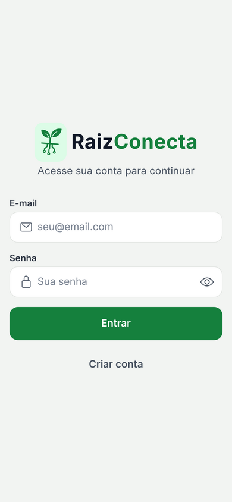
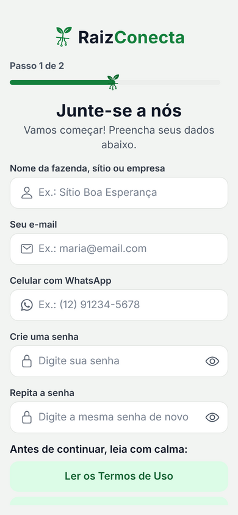
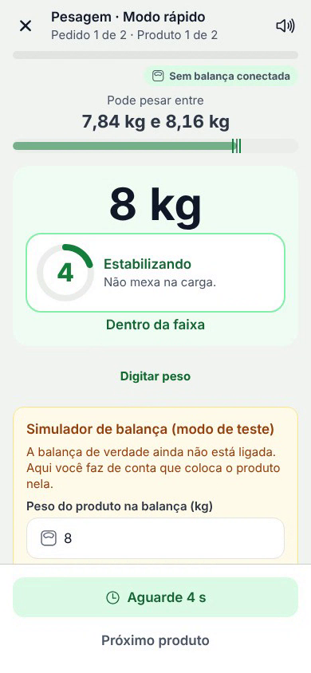
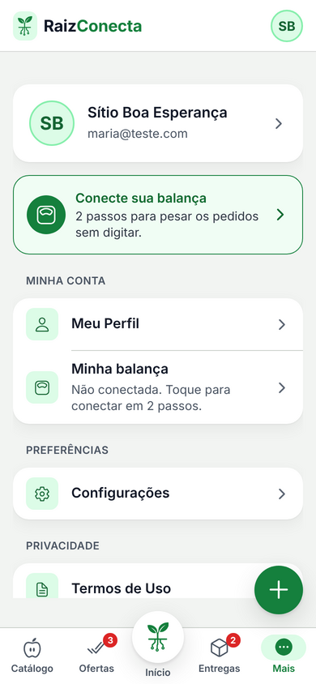
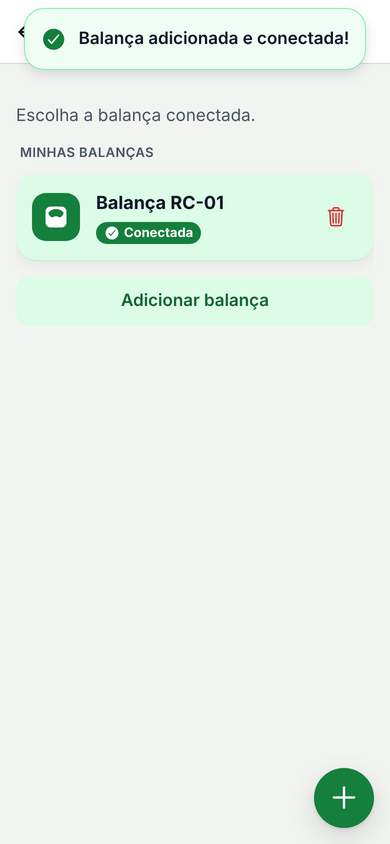
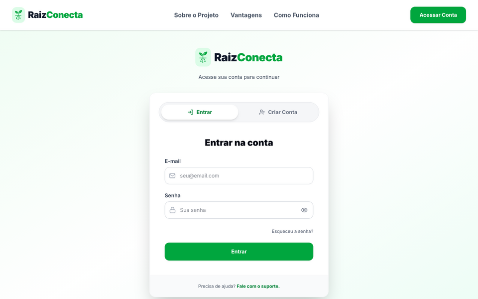
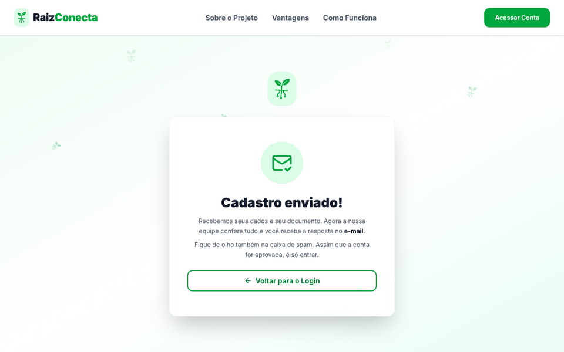
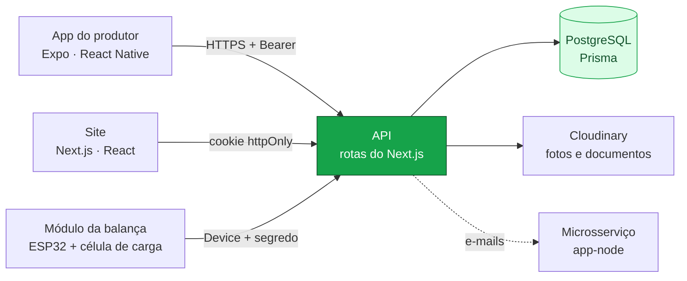
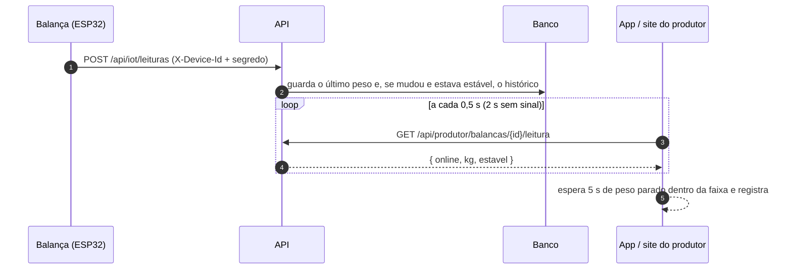
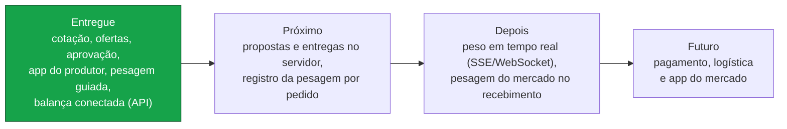

<div align="center">


<br>

**O mercado diz o que precisa. O produtor da região responde. A balança confere o peso.**

O Raiz Conecta liga **produtores rurais** a **mercados e hortifrutis** sem atravessador:<br>
o mercado monta uma cotação, os produtores fazem as ofertas e, no dia da entrega, o app guia a pesagem produto por produto.

<br>


[**Ver em ação**](#-veja-em-ação) ·
[**Recursos**](#-o-que-ele-faz) ·
[**Rodar em 1 minuto**](#-rodar-em-1-minuto) ·
[**Como funciona**](#%EF%B8%8F-como-funciona-por-dentro) ·
[**Documentação**](#-documentação)

</div>

---

## 🎬 Veja em ação

<table>
<tr>
<td width="30%" valign="top" align="center">
<br>
<sub><b>App do produtor</b> · a pesagem diz o que pesar, mostra a faixa aceita, espera o peso <b>parar 5 s</b> e confirma sozinha</sub>
</td>
<td width="70%" valign="top" align="center">
<br>
<sub><b>Site do mercado</b> · busca, quantidade, <b>Revisar e disparar</b>: os produtores da região recebem o pedido</sub>
<br><br>
<br>
<sub><b>Peso ao vivo</b> · o módulo ESP32 manda a leitura para o servidor; o site e o app mostram o mesmo número</sub>
</td>
</tr>
</table>

---

## 🧭 Por que existe

<table>
<tr>
<td width="50%" valign="top">

### Antes

- O produtor vende para o **atravessador**, que fica com boa parte da margem
- O mercado compra caro e sem saber quem plantou
- Pedido combinado por telefone ou mensagem, sem registro
- Peso anotado à mão: a diferença só aparece na hora de receber

</td>
<td width="50%" valign="top">

### Com o Raiz Conecta

- O mercado **publica a cotação** e os produtores próximos ofertam direto
- Cada conta passa por **aprovação** (documento conferido pela equipe)
- Pedido, oferta e entrega ficam registrados, com **avaliação** do produtor
- A **balança conectada** pesa cada produto e o app confere a tolerância (±2%)

</td>
</tr>
</table>

---

## 🧩 O que ele faz

Três partes que usam a **mesma API**: o site (mercado, produtor e administração), o app do produtor e o módulo da balança.

### 🌐 Site

<table>
<tr>
<td width="33%" valign="top">


**🛒 Cotação do mercado**<br>
<sub>Catálogo com busca, categoria e ordem por preço. A cotação fica ao lado e sobrevive a um recarregar.</sub>
</td>
<td width="33%" valign="top">


**📨 Revisar e disparar**<br>
<sub>Quantidades, endereço de entrega e a estimativa pelo preço de referência. Depois, <b>Minhas cotações</b> acompanha as ofertas.</sub>
</td>
<td width="33%" valign="top">


**🤝 Ofertas do produtor**<br>
<sub>Os pedidos abertos da região, quanto já foi garantido e quanto falta. O produtor oferta só a parte que tem.</sub>
</td>
</tr>
<tr>
<td valign="top">


**📊 Painel do produtor**<br>
<sub>Receita estimada, o que responder primeiro e a receita por produto — as mesmas abas e a mesma ordem do app.</sub>
</td>
<td valign="top">


**⚖️ Minha balança**<br>
<sub>Conectar pela etiqueta (endereço + código, ou o texto do QR), renomear, trocar e ver o <b>peso ao vivo</b>.</sub>
</td>
<td valign="top">


**🛡️ Administração**<br>
<sub>Aprovar contas, gerir usuários, produtos, sugestões e balanças (cadastrar o módulo, gerar o segredo, liberar).</sub>
</td>
</tr>
</table>

### 📱 App do produtor

<table>
<tr>
<td align="center" width="20%"><br><sub><b>Painel</b> · receita e o que vem a seguir</sub></td>
<td align="center" width="20%"><br><sub><b>Ofertas</b> · aceitar só uma parte do pedido</sub></td>
<td align="center" width="20%"><br><sub><b>Entregas</b> · por dia e por mercado</sub></td>
<td align="center" width="20%"><br><sub><b>Pesagem</b> · pedido em destaque e tolerância ±2%</sub></td>
<td align="center" width="20%"><br><sub><b>Confirmação</b> · retire o produto, vem o próximo</sub></td>
</tr>
</table>

<details>
<summary><b>Mais telas: cadastro, Mais, balança, site no celular</b></summary>

<table>
<tr>
<td align="center"><br><sub>Login</sub></td>
<td align="center"><br><sub>Cadastro em 2 passos</sub></td>
<td align="center"><br><sub>Peso firmando (5 s)</sub></td>
<td align="center"><br><sub>Mais</sub></td>
<td align="center"><br><sub>Minhas balanças</sub></td>
<td align="center"><br><sub>Site no celular</sub></td>
</tr>
</table>

| Tela inicial | Entrar | Cadastro enviado |
| --- | --- | --- |
|  |  |  |

</details>

> [!TIP]
> **Pesagem sem susto.** O app só registra quando o peso **fica parado 5 segundos dentro da faixa**. Fora dela, o botão fica laranja (abaixo do mínimo) ou vermelho (acima do pedido) e nada é gravado sozinho. A voz fala o próximo produto só quando ele aparece na tela.

---

## 🚀 Rodar em 1 minuto

### Só o app, sem servidor (dados simulados)

Requisito: **Node.js 20+**. Nenhum banco, nenhuma chave.

```bash
cd app-mobile
npm install
cp .env.example .env      # já vem com EXPO_PUBLIC_USE_MOCKS=true
npx expo start            # abra no Expo Go, no emulador ou aperte "w" para o navegador
```

No modo simulado **qualquer e-mail e senha entram** como produtor aprovado, e a pesagem tem um **simulador de balança** na própria tela. Para ver os bloqueios: e-mails que começam com `analise@`, `rejeitado@` ou `suspenso@`.

### O site e a API

Requisito: **Node.js 20+** e um **PostgreSQL** (o projeto usa Neon).

```bash
cd app-principal
npm install
cp .env.example .env.local    # DATABASE_URL, JWT_SECRET, ADMIN_SENHA_INICIAL, CLOUDINARY_*
npx prisma generate
npx prisma db push            # cria as tabelas (inclui as das balanças)
npm run dev                   # http://localhost:3000
```

Abra `/api/setup-admin` uma vez para criar o primeiro administrador. A documentação da API, testável, fica em **`/api-docs`**.

<details>
<summary><b>Ligar o app ao site</b></summary>

No `app-mobile/.env`:

```env
EXPO_PUBLIC_USE_MOCKS=false
EXPO_PUBLIC_API_URL=http://SEU-IP:3000      # emulador Android: http://10.0.2.2:3000
```

Reinicie com `npx expo start -c`. Login, cadastro, catálogo, sugestão, perfil e **balança** passam a usar o servidor. Propostas, entregas e o registro da pesagem continuam simulados até o site ter essas rotas.

</details>

<details>
<summary><b>A balança (ESP32 + célula de carga)</b></summary>

1. No site, como admin: **Balanças → Cadastrar balança** com o endereço MAC do módulo. O **segredo** aparece uma única vez: grave-o no módulo.
2. O módulo envia as leituras para `POST /api/iot/leituras` (firmware de exemplo em [`app-principal/docs/iot/`](app-principal/docs/iot/raiz_balanca)).
3. O produtor conecta a balança em **Mais → Minha balança** com o endereço e o código da etiqueta.

Sem hardware, dá para fazer de conta com `curl`: o roteiro está em [`docs/IOT.md`](app-principal/docs/IOT.md#testar-sem-hardware).

</details>

<details>
<summary><b>Publicar (Vercel) e gerar o app (EAS)</b></summary>

| O quê | Como |
| --- | --- |
| Site e API | Vercel com a raiz em `app-principal`, build `next build`. Configure as variáveis em **Production e Preview** — sem `JWT_SECRET` o site recusa logins de propósito |
| Banco | `npx prisma db push` (ou `migrate deploy`) uma vez por mudança, fora do build |
| App Android | `npx eas-cli@latest build -p android --profile preview` (gera o APK) |

</details>

> [!IMPORTANT]
> `JWT_SECRET` é **obrigatória** em produção: assina os logins e gera os códigos das etiquetas das balanças. Trocar a chave invalida as sessões e muda os códigos impressos.

---

## 👥 Quem faz o quê

| Perfil | Onde | O que pode fazer |
| --- | --- | --- |
| 🏪 **Mercado** | Site | Montar e disparar cotações, acompanhar as ofertas, avaliar o produtor, cancelar em até 7 dias úteis |
| 🌱 **Produtor** | App e site | Escolher o que vende, ofertar nos pedidos, separar e **pesar** as entregas, sugerir produtos, conectar a balança |
| 🛡️ **Administrador** | Site | Aprovar ou recusar cadastros, editar usuários, cuidar do catálogo e das sugestões, cadastrar e liberar balanças |
| ⚖️ **Balança** | Módulo ESP32 | Enviar o peso, com segredo próprio (só o hash fica no servidor) |

Passo a passo de cada perfil, com capturas: [**Guia de uso**](docs/GUIA-DE-USO.md).

---

## ⚙️ Como funciona por dentro

Uma regra guia os dois projetos: **regras de negócio em funções puras e testadas; as telas só montam componentes.**



O caminho de um peso, do prato da balança até a tela:



<details>
<summary><b>Decisões que valem lembrar</b></summary>

- **O e-mail vem sempre da sessão**, nunca do corpo da requisição. Recurso de outra pessoa responde 404, para não revelar o que existe.
- **Sessão sem token no navegador**: o site usa cookie httpOnly; o app guarda o token no armazenamento seguro do aparelho.
- **Falha fechada**: sem `JWT_SECRET` em produção, o login para de funcionar em vez de aceitar tokens forjados.
- **Etiqueta da balança com código derivado do servidor** (HMAC): saber o MAC não basta para tomar a balança de outra pessoa.
- **Mesmo contrato, dois clientes**: o app troca dados simulados por API real só pelo `.env` (`EXPO_PUBLIC_USE_MOCKS`), sem mexer nas telas.
- **Cadastro em duas etapas sem guardar senha**: o passo 1 fica só na memória da página.
- **Tentativas limitadas** em login, troca de senha e código da etiqueta.

</details>

<details>
<summary><b>Estrutura do repositório</b></summary>

```
raiz_conecta/
├── app-principal/      Site + API (Next.js 16, Prisma, Tailwind 4)   → ARQUITETURA.md
│   ├── src/app/        páginas e rotas da API
│   ├── src/components/ kit de UI e componentes por área
│   ├── src/hooks/      controllers das telas
│   ├── src/lib/        regras puras e testadas (auth, iot, perfil, mercado...)
│   ├── prisma/         modelo do banco e migrações
│   └── docs/           IOT.md e o firmware de exemplo do ESP32
├── app-mobile/         App do produtor (Expo SDK 57, Expo Router)    → ARQUITETURA.md
│   └── src/            app/ (telas) · components/ · hooks/ · services/ (API ou simulado) · lib/
├── app-node/           Microsserviço de e-mails (Express)
└── docs/               guia de uso, projeto interdisciplinar e imagens deste README
```

</details>

### 🧰 Stack

| Camada | Tecnologia |
| --- | --- |
| Site | **Next.js 16** (App Router) + **React 19**, **Tailwind CSS 4**, framer-motion, sonner |
| App | **Expo SDK 57** + **React Native 0.86**, Expo Router, expo-speech (voz da pesagem) |
| API e dados | Rotas do Next.js, **Prisma 6**, **PostgreSQL** (Neon), JWT HS256, bcrypt, Cloudinary |
| IoT | **ESP32** + célula de carga (HX711), envio por Wi-Fi com segredo por dispositivo |
| Qualidade | **Vitest** (site), **Jest** (app), roteiros ponta a ponta com **Playwright**, ESLint, TypeScript estrito |

---

## ✅ Qualidade

<div align="center">

| 491 | 934 | 10 | 27 |
| :---: | :---: | :---: | :---: |
| testes do site e da API | testes do app | roteiros ponta a ponta do app | rotas da API documentadas no Swagger |

</div>

Os testes cobrem as regras (validação, tolerância da pesagem, preços, etiqueta da balança, sessão) e cada rota da API. Um teste falha se alguma rota ficar sem documentação no Swagger. Os roteiros ponta a ponta abrem o app no navegador e fazem o caminho de um produtor: entrar, aceitar ofertas, pesar um pedido inteiro, conectar a balança e testar telas de 320 px até tablet.

---

## 📚 Documentação

| | |
| --- | --- |
| 📖 [**Guia de uso**](docs/GUIA-DE-USO.md) | Passo a passo do mercado, do produtor (app e site), do administrador e da balança |
| 🏗️ [**Arquitetura do site**](app-principal/ARQUITETURA.md) | Camadas, kit de componentes, padrão das rotas, como criar uma tela ou rota nova |
| 📱 [**Arquitetura do app**](app-mobile/ARQUITETURA.md) | MVC com gateways, modo simulado, pesagem, animações e acessibilidade |
| ⚖️ [**IoT — a balança**](app-principal/docs/IOT.md) | Autenticação do módulo, rotas, banco e como testar sem hardware |
| 🔌 [**API (Swagger)**](https://raiz-conecta-qa94.vercel.app/api-docs) | Todas as rotas, testáveis com o token do login |
| 🎓 [**Projeto Interdisciplinar**](docs/PROJETO-INTERDISCIPLINAR.md) | Problema, público, ODS, sprints, equipe e referências |
| 📕 [**Documento do projeto (Word)**](Raiz_Conecta_Documentacao.docx) | A documentação acadêmica completa |

---

## 🗺️ Roadmap



<details>
<summary><b>Limites conhecidos</b></summary>

- **Propostas com preço fixo, entregas e o registro da pesagem** ainda são simulados no app: o site não tem essas rotas.
- O módulo real da balança ainda não foi testado em campo; o firmware de exemplo usa `setInsecure()` (só para bancada).
- CPF e CNPJ são conferidos pelo tamanho, não pelo dígito verificador (o documento é analisado pela equipe).
- Os limites de tentativas ficam na memória de cada instância do servidor; para um limite global, Redis.
- As rotas não têm versão (`/api/v1`) para não quebrar o app já instalado.

</details>

---

<div align="center">

<sub>Identidade visual: o <b>verde</b> da folha e do campo, o <b>broto com raízes de circuito</b> da logo — o rural e a tecnologia na mesma planta — e o <b>âmbar</b> da balança.</sub>

<br><br>

Feito por **Daniel Henrique Domingues Nogueira**, **Felipe Gomes Felix**, **[Guilherme Vinícius Baeza de Oliveira](https://github.com/IneGuilherme)**, **Gustavo Henrique Bauch** e **Jhonatan Melo de Oliveira**<br>
<sub>Projeto Interdisciplinar · Desenvolvimento de Software Multiplataforma — Fatec Votorantim · 2026 · <a href="https://www.instagram.com/raizconecta_dsm">@raizconecta_dsm</a></sub>

</div>
