<div align="center">


<br>

**Plataforma B2B que conecta produtores rurais a mercados e hortifrútis, sem atravessador.**

Projeto Interdisciplinar · Desenvolvimento de Software Multiplataforma · Fatec Votorantim

<br>


[**Resumo**](#resumo) ·
[**Em andamento**](#-o-que-estamos-fazendo-agora) ·
[**Descrição**](#1-descrição-do-projeto) ·
[**Requisitos**](#2-requisitos-do-projeto) ·
[**Projeto do software**](#3-projeto-do-software) ·
[**Testes**](#4-testes) ·
[**Como executar**](#5-repositório-e-como-executar)

</div>

> Este README resume a **documentação completa do projeto** ([`Raiz_Conecta_Documentacao.docx`](Raiz_Conecta_Documentacao.docx), versão 3.0, outubro de 2026), na mesma ordem dos capítulos. Onde o código mudou desde o documento, o texto já traz a situação de **novembro de 2026**. As figuras marcadas com *(documento v3.0)* vêm do documento original.

---

## Resumo

O **Raiz Conecta** é uma plataforma digital B2B que aproxima produtores rurais de mercados e hortifrútis. O sistema tem três partes que usam a mesma API:

- **Aplicação web** (Next.js, React, Prisma e PostgreSQL): cadastro em duas etapas com validação documental, catálogo oficial, fluxo de **demanda reversa** (o mercado publica o que precisa e os produtores ofertam), ofertas fracionadas, cancelamento por prazo em dias úteis, avaliação de produtores e painel administrativo.
- **Aplicativo mobile do Produtor** (Expo e React Native): pedidos de mercado com preço fixo e janela de resposta de 30 minutos, painel, entregas em dias definidos e **pesagem guiada** com tolerância de ±2% e conferência de peso estável.
- **Balança conectada** (ESP32 com célula de carga): manda o peso para o servidor, e o app e o site mostram a leitura ao vivo.

Um microsserviço independente (Express e Nodemailer) envia os e-mails transacionais. Toda a base é testada: 498 testes no site e na API e 934 no aplicativo.

*Palavras-chave: plataforma B2B; produtores rurais; mercados; demanda reversa; Next.js; Expo; pesagem; IoT; JWT; Prisma.*

### Links do projeto

| Recurso | Link |
| --- | --- |
| Aplicação | [raiz-conecta-qa94.vercel.app](https://raiz-conecta-qa94.vercel.app) |
| Documentação da API (Swagger) | [/api-docs](https://raiz-conecta-qa94.vercel.app/api-docs) |
| Repositório | [github.com/Felipe3388/Raiz_conecta](https://github.com/Felipe3388/Raiz_conecta) |
| Confluence | [raizconectado.atlassian.net/wiki/spaces/GGP](https://raizconectado.atlassian.net/wiki/spaces/GGP) |
| Jira (Scrum) | [Quadro SCRUM](https://raizconectado.atlassian.net/jira/software/projects/SCRUM/boards/1) |
| Instagram | [@raizconecta_dsm](https://www.instagram.com/raizconecta_dsm) |

---

## 🚧 O que estamos fazendo agora

*Situação em novembro de 2026, na branch `teste`.*

O documento v3.0 terminou com uma recomendação: refatorar o `app-principal` em duas frentes, primeiro a segurança e o contrato da API, depois o novo fluxo de pedidos, entregas e pesagem. A primeira frente está feita; a segunda começou pela balança.

| Frente | O que mudou | Situação |
| --- | --- | --- |
| **Segurança da API** | Todas as rotas conferem a sessão (JWT verificado); a identidade vem do token, não do e-mail enviado pelo cliente; senha com bcrypt e troca exigindo a senha atual; sem segredo JWT de reserva em produção | ✅ Feito |
| **Contrato da API** | Swagger gerado por script, cobrindo todas as rotas, com um teste que falha se alguma ficar de fora | ✅ Feito |
| **Site refeito** | Landing, login e cadastro novos; área do produtor adaptada do app para a tela grande (menu lateral, Início em colunas, Ofertas em tabela); kit de componentes único; tela de "cadastro enviado" | ✅ Feito |
| **Balança (IoT)** | Cadastro do módulo pelo administrador, vínculo pelo código da etiqueta, leituras do ESP32 no servidor e peso ao vivo no app e no site; firmware de exemplo | ✅ API pronta · 🔧 falta testar o módulo em campo |
| **App mobile** | Login, cadastro, catálogo, sugestão, perfil e **balança** usam a API real | 🔧 Parcial |
| **Pedidos com preço fixo, entregas e registro da pesagem** | Modelo de dados e rotas propostos no documento (seção 3.9.3); no app ainda funcionam com dados simulados | ⏳ Próximo passo |

<table>
<tr>
<td width="30%" valign="top" align="center">
<br>
<sub><b>App</b> · a pesagem espera o peso ficar parado 5 s dentro da faixa e confirma sozinha</sub>
</td>
<td width="70%" valign="top" align="center">
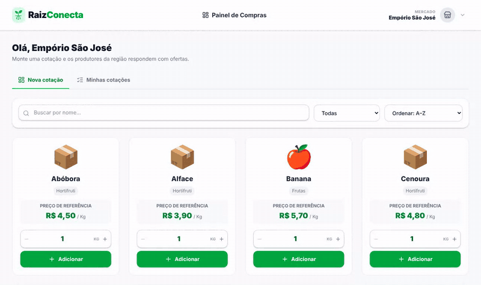<br>
<sub><b>Site do mercado</b> · busca, quantidade e Revisar e disparar</sub>
<br><br>
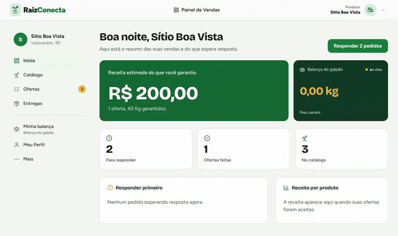<br>
<sub><b>Peso ao vivo</b> · a leitura do ESP32 chega ao servidor e aparece no site e no app</sub>
</td>
</tr>
</table>

---

## 1. Descrição do projeto

### 1.1 Proposta do software

O Raiz Conecta moderniza e desburocratiza a relação comercial entre produtores rurais e estabelecimentos varejistas. O objetivo é facilitar a compra e venda de produtos frescos diretamente da fonte, com agilidade, economia e transparência.

**Problema.** A cadeia de distribuição de alimentos frescos tem ineficiências que prejudicam as duas pontas. Mercados têm dificuldade para encontrar fornecedores confiáveis e com preço competitivo; produtores não têm canais diretos para escoar a produção e dependem de intermediários que reduzem sua margem. O resultado é desperdício, preço alto para o consumidor e trabalho do produtor subvalorizado.

**Público-alvo.** (i) Mercados, hortifrútis e mercearias de pequeno e médio porte, que buscam produtos frescos com procedência e bom preço; (ii) produtores rurais de pequeno e médio porte, que querem vender mais e com melhor retorno.

**Escopo.** O núcleo é a demanda reversa: o mercado publica a necessidade; os produtores que têm o produto no catálogo veem a oportunidade e ofertam a quantidade total ou parcial. Sobre esse núcleo, o aplicativo do Produtor acrescenta pedidos com preço fixo por produto, janela de 30 minutos e conferência de peso na entrega. Ficam fora desta versão: pagamento integrado, logística com rastreamento em tempo real e interface para entregadores.

<details>
<summary><b>Componentes do ecossistema e situação</b> (Tabela 1 do documento, atualizada)</summary>

| Componente | Pasta | Tecnologia | Situação |
| --- | --- | --- | --- |
| Aplicação web e API | `app-principal` | Next.js 16.2.3, React 19.2.4, Prisma 6.19.3 | **Implementado** e refatorado |
| Aplicativo mobile do Produtor | `app-mobile` | Expo SDK 57, React Native 0.86.3 | **Parcial**: telas completas; parte usa a API real |
| Módulo da balança | `app-principal/docs/iot` | ESP32 + HX711, firmware Arduino | **API implementada**; firmware de exemplo, sem teste em campo |
| Microsserviço de e-mail | `microservico` | Express 5.2.1, Nodemailer 8.0.5 | **Implementado** |
| Backend Express anterior | `app-node` | Express, Prisma | Legado (fora do fluxo ativo) |

</details>

### 1.2 Justificativa e ODS

A plataforma integra produtores e compradores e funciona como vitrine para apresentar produtores a mercados que ainda não tiveram contato direto com quem planta. Promove inclusão digital no agronegócio, redução do desperdício e renda justa. O aplicativo reforça essa proposta: o produtor, que muitas vezes trabalha longe do computador, responde pedidos, separa a carga e confere o peso pelo celular, com letras grandes, poucos toques e linguagem simples.

| ODS | Como o projeto contribui |
| --- | --- |
| **2** · Fome zero e agricultura sustentável | Menos desperdício com uma logística mais direta entre produtor e mercado |
| **8** · Trabalho decente e crescimento econômico | Renda justa para o produtor, sem intermediários que reduzem a margem |
| **12** · Consumo e produção responsáveis | Pedido certo e peso conferido, com menos perda na cadeia |
| **17** · Parcerias e meios de implementação | Tecnologia para parcerias diretas e transparentes entre produtores e varejistas |

### 1.3 Mapa do site e do aplicativo

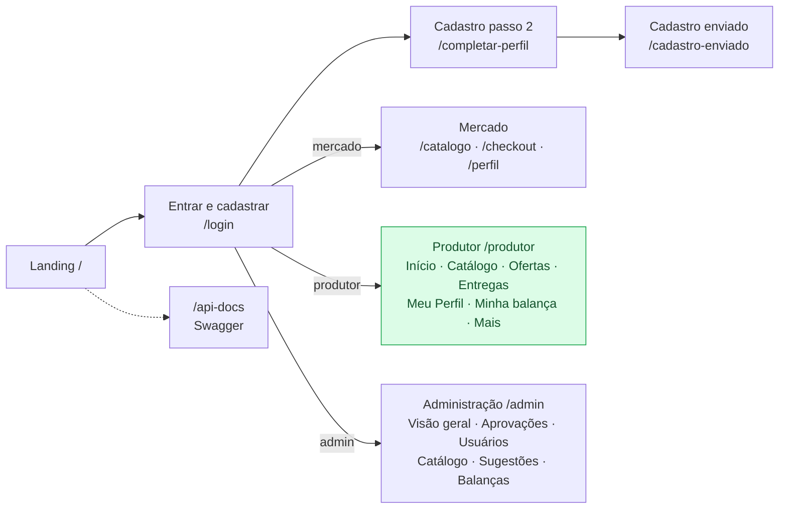

<details>
<summary><b>Navegação do aplicativo</b> (documento v3.0)</summary>

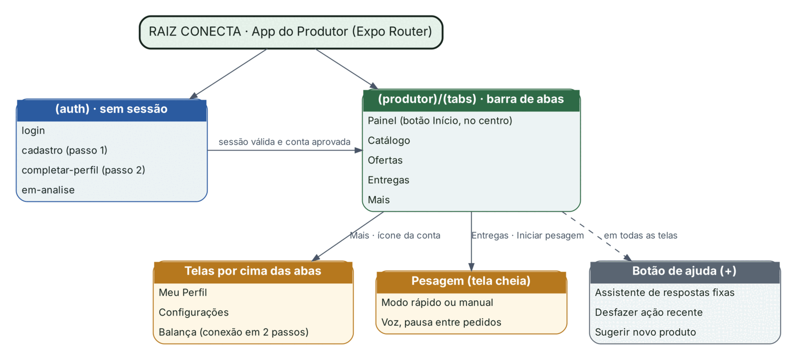

</details>

### 1.4 Logomarca

A identidade usa tons de verde (natureza, agricultura e sustentabilidade) e um símbolo de broto com raízes de circuito: o campo e a tecnologia na mesma planta. O mesmo desenho vetorial é usado no site e no app (`components/brand/logoPaths.ts` nos dois projetos). Na versão atual do site, os títulos usam **Bricolage Grotesque**, a interface usa **Figtree** e o âmbar é reservado à balança e aos avisos.

### 1.5 Funcionalidades da aplicação web

<table>
<tr>
<td width="50%" valign="top">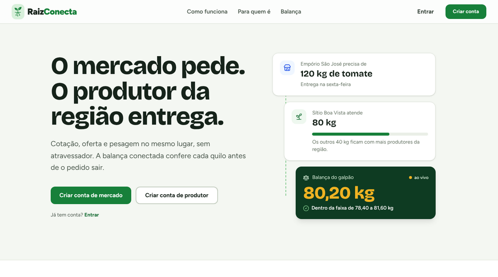<br><sub><b>Landing</b> · o caminho de um pedido (mercado pede, produtor atende, balança confere), como funciona em 4 passos, para quem é, a balança e os ODS</sub></td>
<td width="50%" valign="top">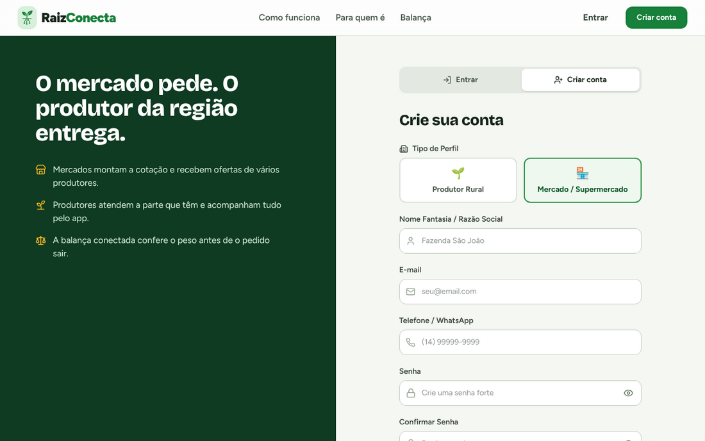<br><sub><b>Cadastro em dois passos</b> · tipo de conta, dados de acesso com senha forte; depois CPF/CNPJ, CEP com ViaCEP e foto do documento</sub></td>
</tr>
<tr>
<td valign="top">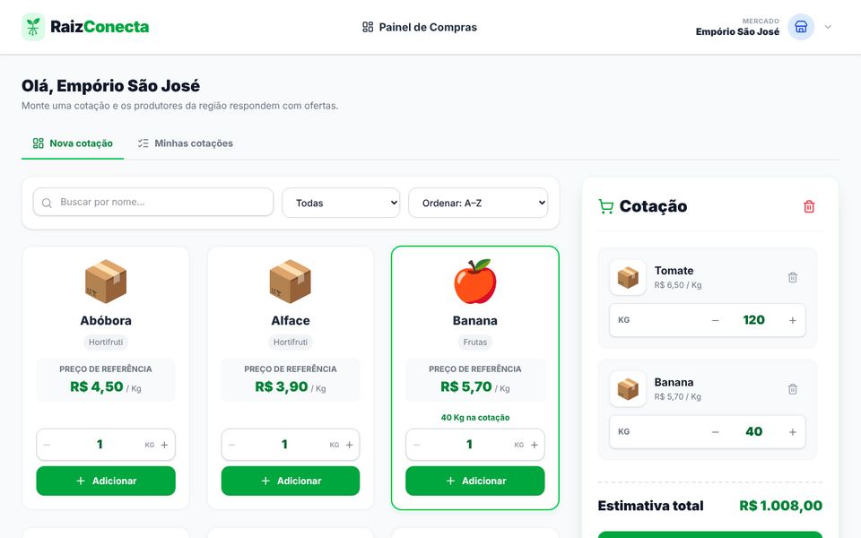<br><sub><b>Mercado</b> · catálogo com busca, categoria e ordem; cotação ao lado, guardada no navegador</sub></td>
<td valign="top">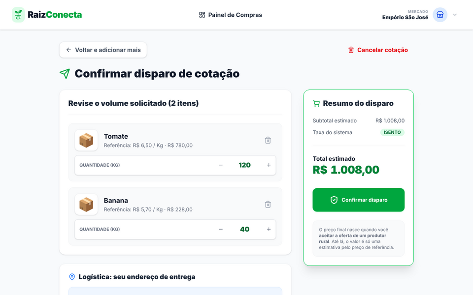<br><sub><b>Revisar e disparar</b> · quantidades, endereço do perfil e a estimativa; cria uma demanda ABERTA por item</sub></td>
</tr>
<tr>
<td valign="top">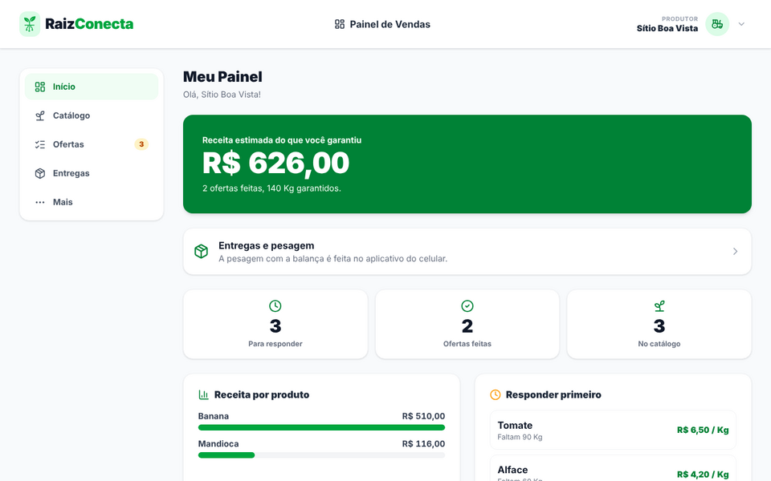<br><sub><b>Produtor</b> · Início com a receita, a balança ao vivo, os números e o que responder primeiro</sub></td>
<td valign="top">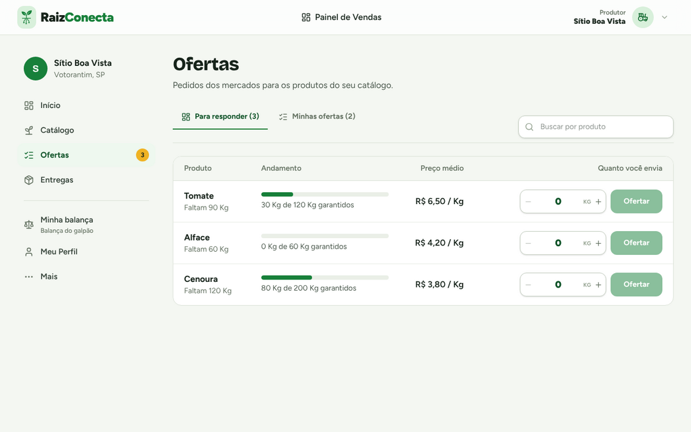<br><sub><b>Ofertas</b> · no computador, uma tabela com o andamento e a oferta na própria linha; no celular, cartões</sub></td>
</tr>
<tr>
<td valign="top">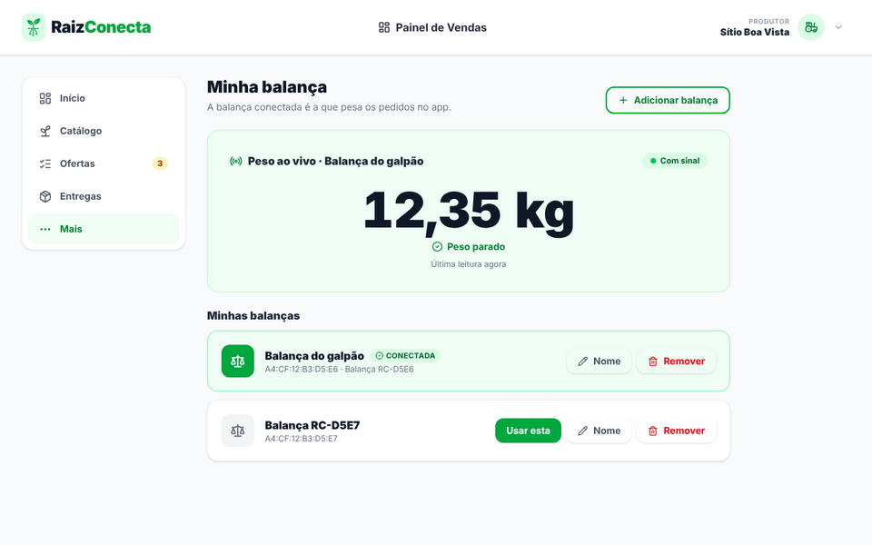<br><sub><b>Minha balança</b> · conectar pela etiqueta (ou o texto do QR), renomear, trocar, remover e ver o peso ao vivo</sub></td>
<td valign="top">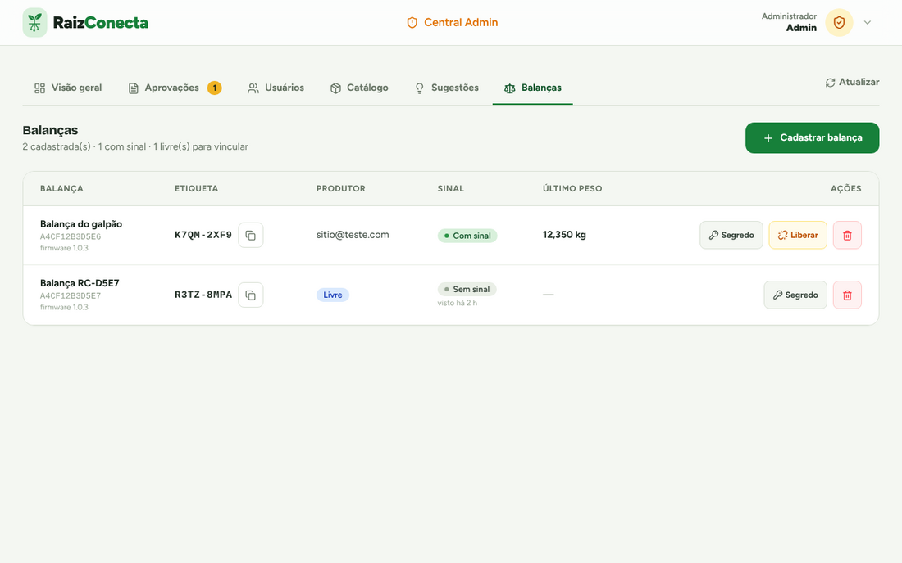<br><sub><b>Administração</b> · aprovações, usuários, catálogo oficial, sugestões e balanças (módulo, segredo, liberar)</sub></td>
</tr>
</table>

<details>
<summary><b>Mais telas do produtor no site</b> (computador e celular)</summary>

<table>
<tr>
<td width="50%" valign="top">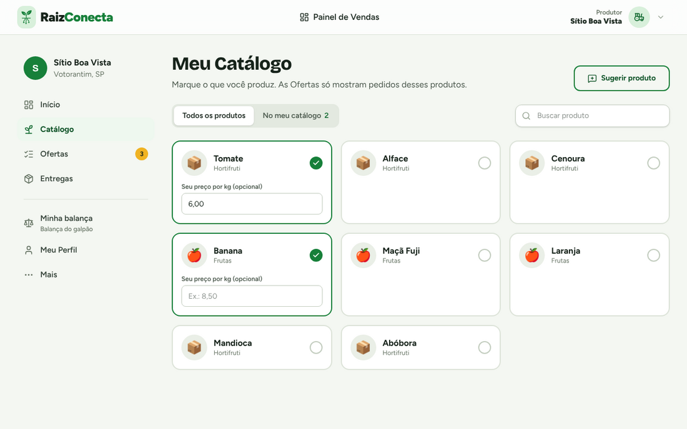<br><sub><b>Catálogo</b> · marcar o que produz, com preço por kg opcional</sub></td>
<td width="50%" valign="top">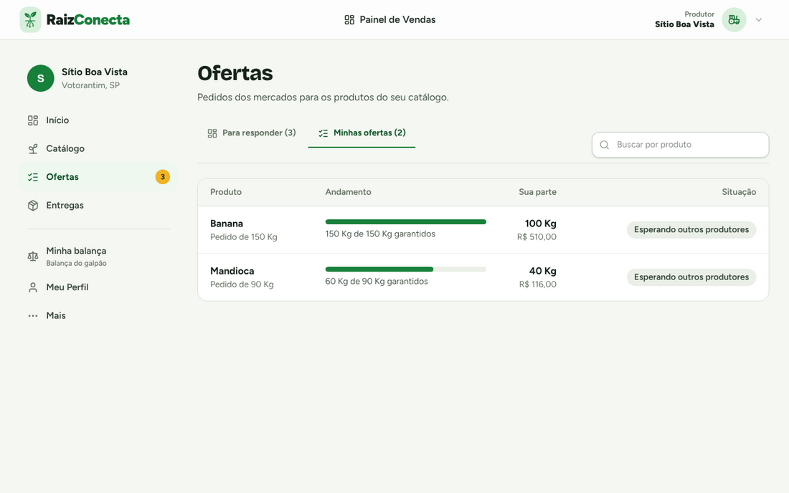<br><sub><b>Minhas ofertas</b> · o andamento de cada pedido e a sua parte</sub></td>
</tr>
<tr>
<td valign="top">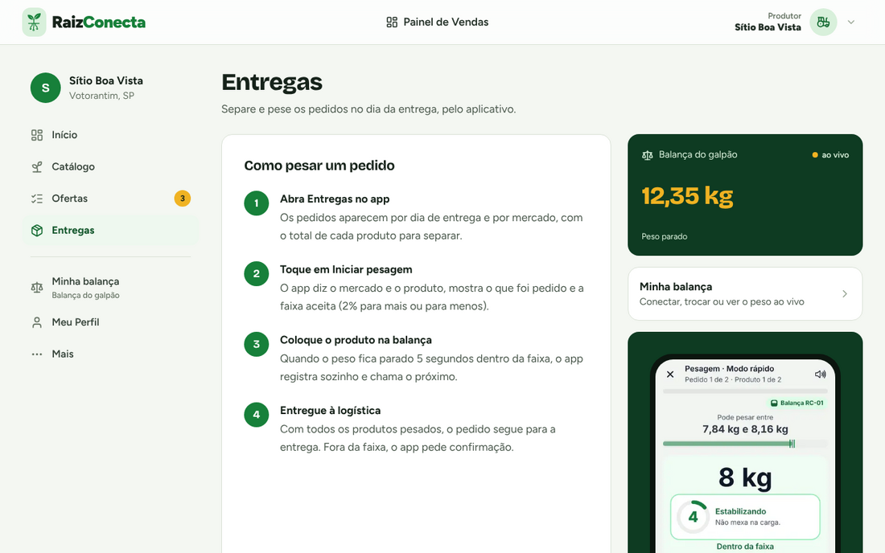<br><sub><b>Entregas</b> · como pesar no app, com a balança ao lado</sub></td>
<td valign="top">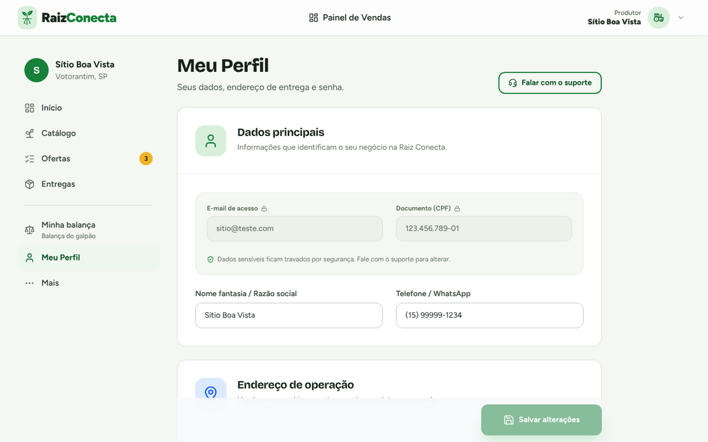<br><sub><b>Meu Perfil</b> · dados, endereço e senha (pede a senha atual)</sub></td>
</tr>
</table>

<table>
<tr>
<td align="center" width="33%">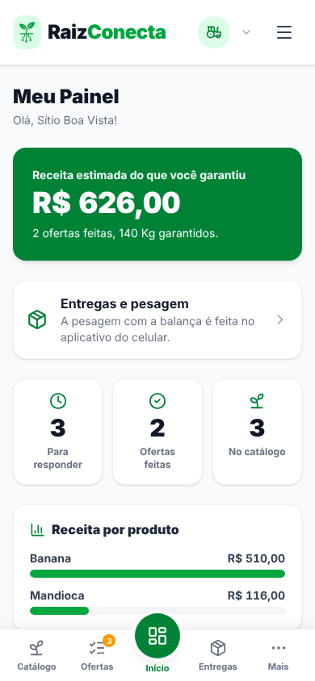<br><sub>No celular · Início</sub></td>
<td align="center" width="33%">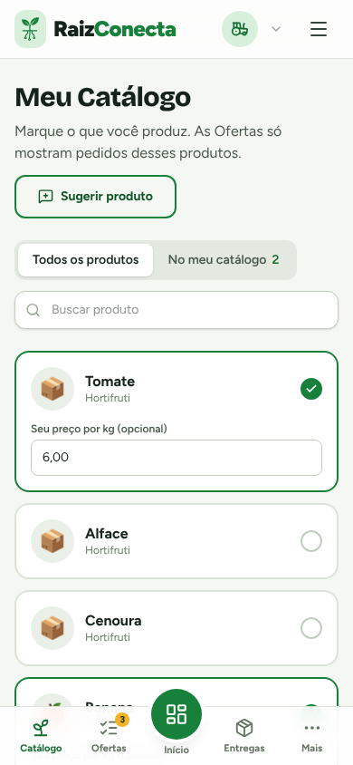<br><sub>Catálogo</sub></td>
<td align="center" width="34%">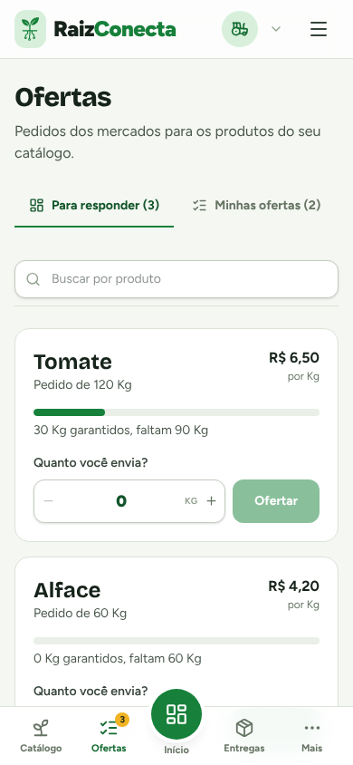<br><sub>Ofertas em cartões</sub></td>
</tr>
</table>

</details>

<details>
<summary><b>Detalhes de cada área</b></summary>

- **Landing.** Pública. Quem já entrou vai direto ao painel do seu perfil.
- **Cadastro.** Passo 1 com e-mail validado, indicador de força e confirmação de senha e máscara de telefone. Passo 2 com CPF/CNPJ (máscara), endereço pelo ViaCEP e documento (RG, CNH, contrato social ou cartão CNPJ). A conta nasce **EM_ANALISE** e um e-mail de boas-vindas é enviado. A senha do passo 1 fica só na memória da página.
- **Login.** E-mail e senha; a API compara com o hash bcrypt e emite um JWT de 2 horas, gravado num **cookie httpOnly** (o site não guarda token no navegador; o app recebe o token na resposta). Contas SUSPENSO e REJEITADO são bloqueadas; EM_ANALISE vê o aviso de análise. Redireciona por perfil: admin → `/admin`, produtor → `/produtor`, mercado → `/catalogo`.
- **Mercado.** Vitrine, cotação, checkout, **Minhas cotações** (andamento, produtores e quantidades), **cancelamento em até 7 dias úteis** (sem sábados e domingos) e **avaliação de 1 a 5** após o recebimento.
- **Produtor.** As mesmas telas e a mesma ordem do app: Início, Catálogo (marcar o que produz, preço por kg opcional, sugerir produto), Ofertas (pedidos compatíveis com o catálogo; oferta total ou parcial), Entregas (como pesar no app e a balança), Meu Perfil e Minha balança.
- **Meus dados.** Nome, telefone, endereço e senha (a troca **exige a senha atual**); e-mail e documento ficam bloqueados (LGPD); exclusão com confirmação (contas com pedidos vinculados não são excluídas).
- **Administração.** Visão geral, aprovação com visualização do documento e e-mail automático, gestão de usuários (buscar, filtrar, editar, suspender, reativar, excluir), catálogo oficial com foto (Cloudinary), sugestões (promover ou descartar), novo administrador e **balanças**.
- **Também:** Termos de Uso e Política de Privacidade (LGPD) em janelas, suporte por e-mail, Microsoft Clarity, avisos em toast e Swagger em `/api-docs`.

</details>

### 1.6 Aplicativo mobile do Produtor

Feito com Expo SDK 57, React Native 0.86.3 e Expo Router, em TypeScript; roda no Android, no iOS e no navegador. É só do produtor, que está no campo ou na separação, com pouco tempo e as mãos ocupadas. Funciona em dois modos trocados pelo `.env`, sem mexer nas telas: **simulado** (`EXPO_PUBLIC_USE_MOCKS=true`) e **real** (`EXPO_PUBLIC_API_URL` apontando para o site).

<table>
<tr>
<td align="center" width="20%">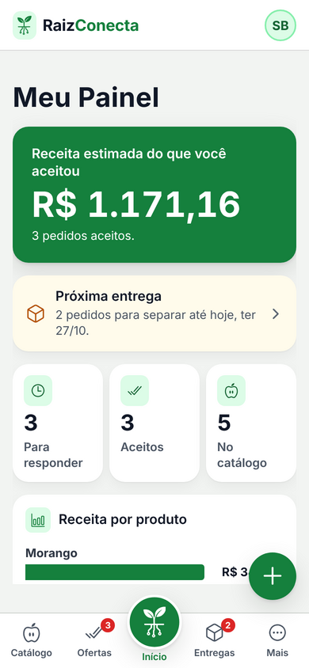<br><sub><b>Painel</b></sub></td>
<td align="center" width="20%">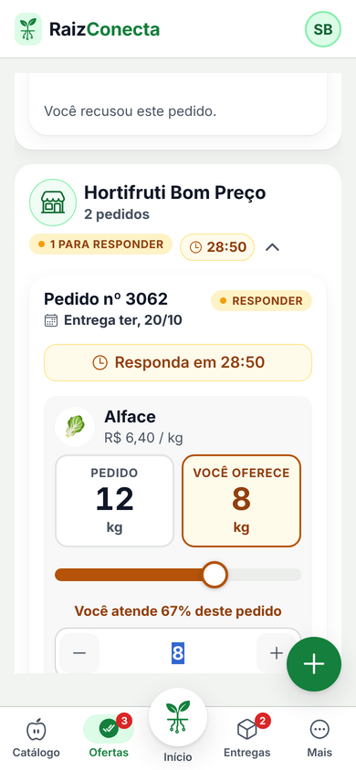<br><sub><b>Ofertas</b> · aceite parcial</sub></td>
<td align="center" width="20%">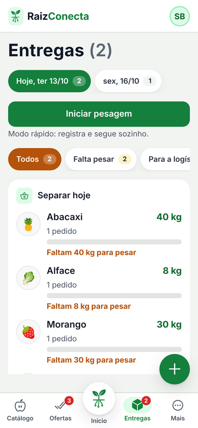<br><sub><b>Entregas</b></sub></td>
<td align="center" width="20%">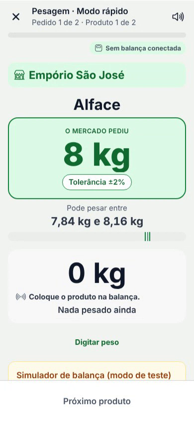<br><sub><b>Pesagem</b> · ±2%</sub></td>
<td align="center" width="20%">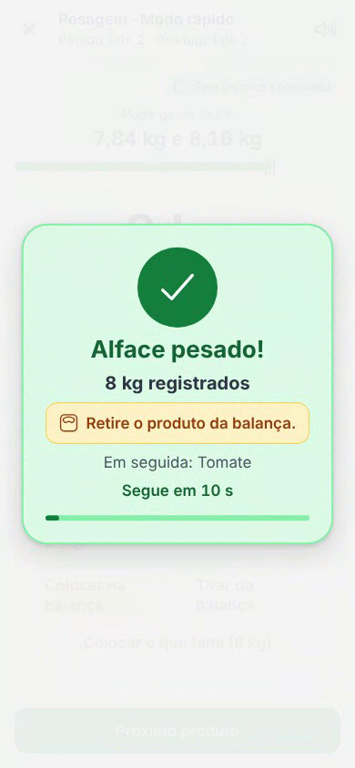<br><sub><b>Confirmação</b></sub></td>
</tr>
</table>

| Função | Situação | Rota ou observação |
| --- | --- | --- |
| Login e sessão | **Real** | `POST /api/auth/login`; token no SecureStore do aparelho |
| Cadastro em dois passos | **Real** | `POST /api/auth/cadastro` com documento |
| Catálogo e sugestão de produto | **Real** | `/api/produtos`, `/api/produtor/meus-produtos`, `/api/produtor/sugestao` |
| Meu Perfil (com senha atual) | **Real** | `GET/PUT/DELETE /api/perfil/meus-dados` |
| **Balança: vínculo e peso ao vivo** | **Real** *(novo)* | `/api/produtor/balancas` e `.../{id}/leitura` |
| Pedidos de mercado com preço fixo | Simulado | rotas propostas na seção 3.9.3 do documento |
| Escada de preços e preço sugerido | Simulado | calculados no servidor na versão real |
| Entregas e registro da pesagem | Simulado | idem |
| Assistente de ajuda | Simulado | respostas fixas, sem IA |

- **Ofertas.** Pedidos por mercado, preço por kg já definido, **30 minutos** para aceitar, aceitar parte ou recusar. O que não foi atendido segue para outro produtor.
- **Entregas.** Dias de entrega definidos pela administração (terça e sexta), lista **Separar hoje** e etapas A SEPARAR → PRONTA → COM A LOGÍSTICA → RECEBIDA (ou DIVERGENTE).
- **Pesagem.** Faixa de **±2%**, mínimo de 1 kg e nunca acima do pedido; registro só depois de **5 s de peso parado**; modos rápido e manual; voz em português; confirmação verde de 10 s com "Retire o produto da balança".
- **Recursos gerais.** Desfazer (5 ações por 1 minuto), assistente, reduzir animações, textos de no mínimo 14 px, campos de 56 px e telas verificadas de 320 × 568 px a 1100 × 800 px.

---

## 2. Requisitos do projeto

O levantamento combinou conversas com produtores e donos de mercado, discussões da equipe e análise de plataformas de comércio de hortifrúti, em ciclos curtos (Scrum). Na fase do aplicativo, cada ciclo partiu de protótipos navegáveis e gerou regras hoje fixadas: unidade única em quilos, tolerância de ±2%, 5 segundos de peso parado e a retirada do preço de venda do painel do produtor.

<details>
<summary><b>Requisitos funcionais (RF001 a RF030)</b></summary>

| Nº | Requisito | Ator | Plat. | Situação |
| --- | --- | --- | --- | --- |
| RF001 | Efetuar login | Todos | Web | Implementado |
| RF002 | Cadastrar usuário em dois passos | Todos | Web | Implementado |
| RF003 | Gerenciar perfil (troca de senha com a senha atual) | Todos | Web | Implementado *(era parcial)* |
| RF004 | Exibir catálogo com busca, categoria e ordem | Mercado | Web | Implementado |
| RF005 | Gerenciar cotação (carrinho) | Mercado | Web | Implementado |
| RF006 | Finalizar pedido (uma demanda ABERTA por item) | Mercado | Web | Implementado |
| RF007 | Cancelar pedido em até 7 dias úteis | Mercado | Web | Implementado |
| RF008 | Confirmar recebimento e avaliar (1 a 5) | Mercado | Web | Implementado |
| RF009 | Mural de oportunidades e oferta parcial | Produtor | Web | Implementado |
| RF010 | Catálogo do produtor e sugestão de produto | Produtor | Web | Implementado |
| RF011 | Catálogo oficial com foto | Admin | Web | Implementado |
| RF012 | Validar cadastros | Admin | Web | Implementado |
| RF013 | Gerenciar usuários | Admin | Web | Implementado |
| RF014 | Gerenciar sugestões | Admin | Web | Implementado |
| RF015 | Enviar e-mails pelo microsserviço | Sistema | Web | Implementado |
| RF016 | Documentar a API (Swagger) | Sistema | Web | Implementado *(era parcial)* |
| RF017 | Entrar no aplicativo | Produtor | App | Real |
| RF018 | Cadastrar-se pelo aplicativo | Produtor | App | Real |
| RF019 | Gerenciar catálogo pelo aplicativo | Produtor | App | Real |
| RF020 | Responder pedidos de mercado em 30 minutos | Produtor | App | Simulado |
| RF021 | Receber preço fixo por produto | Produtor | App | Simulado |
| RF022 | Acompanhar o painel | Produtor | App | Simulado |
| RF023 | Separar e acompanhar entregas | Produtor | App | Simulado |
| RF024 | Pesar produtos (±2%, 5 s, rápido/manual, voz) | Produtor | App | Simulado |
| RF025 | Gerenciar balanças | Produtor | App e web | **Real** *(era simulado)* |
| RF026 | Desfazer ações recentes | Produtor | App | Implementado |
| RF027 | Obter ajuda (assistente) | Produtor | App | Simulado |
| RF028 | Configurar o aplicativo | Produtor | App | Implementado |
| RF029 | Gerenciar perfil pelo aplicativo | Produtor | App | Real |
| RF030 | Definir os dias de entrega | Admin | Web | Planejado |

</details>

<details>
<summary><b>Requisitos não funcionais</b></summary>

| Nº | Requisito | Situação |
| --- | --- | --- |
| RNF001 | PostgreSQL serverless (Neon) | Implementado |
| RNF002 | Navegadores atuais (Chrome, Firefox, Edge, Safari) | Implementado |
| RNF003 | Administração restrita ao perfil admin, no proxy de páginas e em cada rota | Implementado *(era parcial)* |
| RNF004 | Interface responsiva (computador, tablet e celular) | Implementado |
| RNF005 | Mais usuários sem perda de desempenho (Vercel e Neon serverless) | A confirmar |
| RNF006 | Senhas só como hash bcrypt (10 rodadas) | Implementado *(era parcial)* |
| RNF007 | JWT de 2 horas (cookie com a mesma validade) | Implementado |
| RNF008 | Imagens e documentos no Cloudinary | Implementado |
| RNF009 | E-mail independente: falha no envio não interrompe o fluxo | Implementado |
| RNF010 | API documentada no Swagger | Implementado *(era parcial)* |
| RNF011–016 | App em Android, iOS e web; telas adaptativas; acessibilidade; token no SecureStore; simulado/real por `.env`; regras puras com TDD | Implementado |
| RNF017–018 | Preço da proposta e regras de tempo decididos pelo servidor | Planejado |

</details>

### 2.1 Casos de uso

<table>
<tr>
<td width="50%">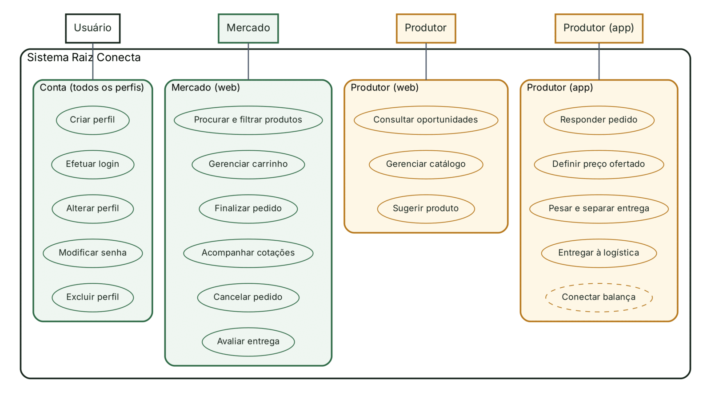<br><sub>Aplicação web: Usuário, Mercado e Administrador <i>(documento v3.0)</i></sub></td>
<td width="50%">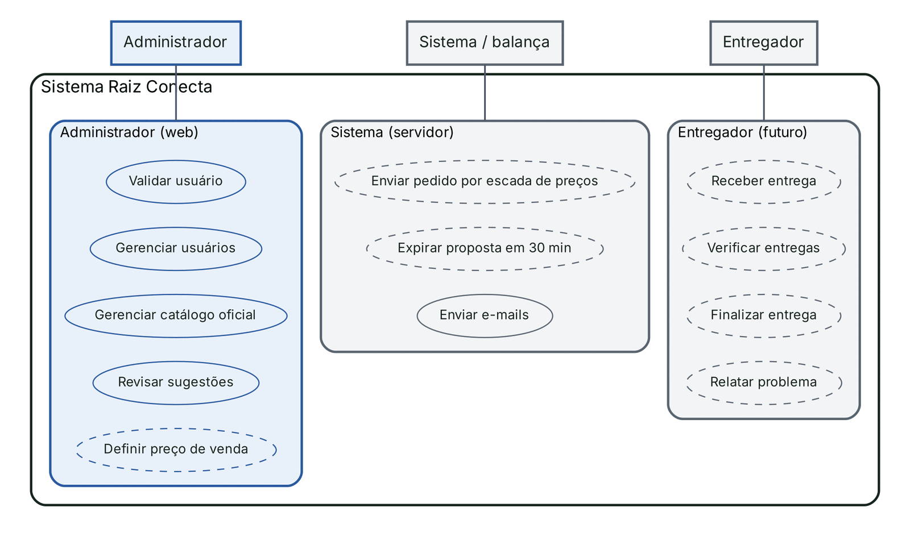<br><sub>Aplicativo do Produtor e funções planejadas <i>(documento v3.0)</i></sub></td>
</tr>
</table>

### 2.2 Regras de negócio

**Estados.** Conta: EM_ANALISE → APROVADO, REJEITADO ou SUSPENSO. Demanda: ABERTA → CONCLUIDA (soma das ofertas atinge o pedido) ou CANCELADA. Oferta: ACEITA, com entrega PENDENTE → ENTREGUE (ou CANCELADA com a demanda).

**Cancelamento.** Até 7 dias úteis desde a criação, sem contar sábados e domingos (feriados ainda não são descontados).

**Pedidos do aplicativo e escada de preços.** Cada item do pedido vai a **um produtor por vez**, com preço fixo. O mercado informa o preço que paga; a primeira proposta sai a 80% dele e, a cada recusa ou expiração (30 min), o pedido passa a outro produtor com um degrau de 2%. Depois de 5 rodadas, volta ao primeiro produtor a 90%. Os fatores são valores de trabalho, a confirmar com o negócio, e devem ficar em configuração no servidor.

**Unidade e pesagem.** Tudo é vendido **por quilo** (1 unidade do pedido = 1 kg).

| Regra | Valor |
| --- | --- |
| Janela de resposta ao pedido | 30 minutos |
| Dias de entrega | terça e sexta |
| Tolerância de peso | ±2% do pedido, mínimo de 1 kg, nunca acima |
| Peso parado | 5 segundos (últimas 5 leituras variam até 0,02 kg ou 0,2%) |
| Confirmação verde / pausa entre pedidos | 10 s / 5 s |
| Balança sem sinal | mais de 15 s sem leitura no servidor |

<table>
<tr>
<td width="34%">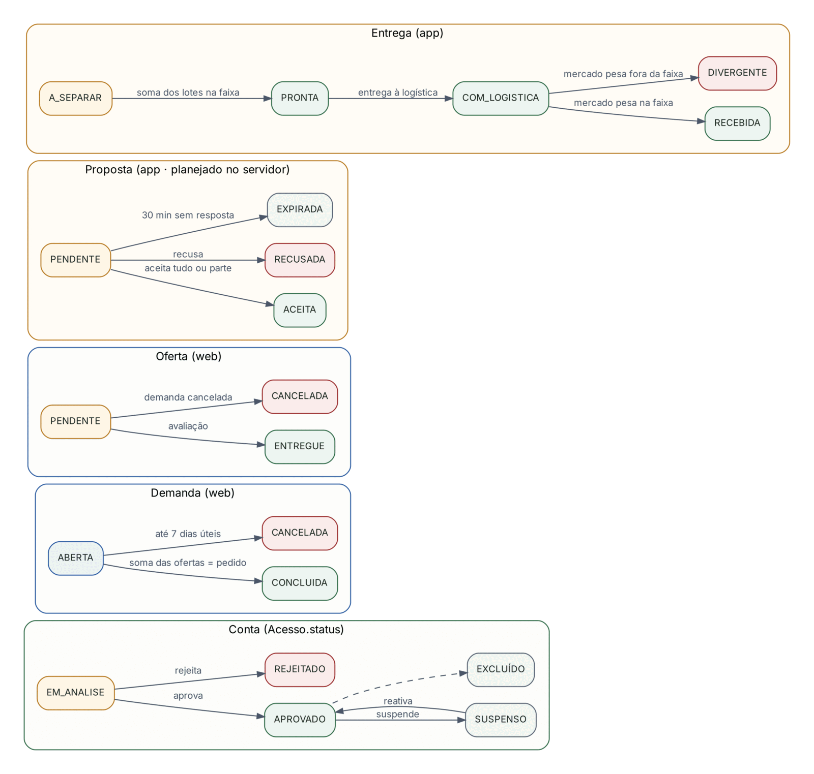<br><sub>Estados <i>(documento v3.0)</i></sub></td>
<td width="33%">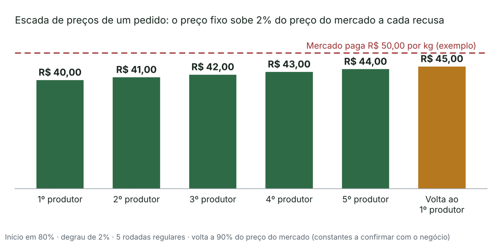<br><sub>Escada de preços de um pedido a R$ 50,00/kg <i>(documento v3.0)</i></sub></td>
<td width="33%">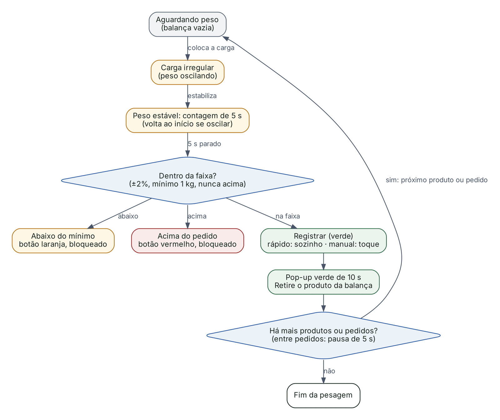<br><sub>Fluxo de pesagem <i>(documento v3.0)</i></sub></td>
</tr>
</table>

### 2.3 Pendências da auditoria e situação atual

O documento levantou 22 pendências no `app-principal` (R01 a R22). A refatoração resolveu as de severidade alta.

<details>
<summary><b>Ver a tabela R01–R22</b></summary>

| ID | Sev. | Problema | Situação em nov/2026 |
| --- | --- | --- | --- |
| R01 | Alta | APIs administrativas sem verificação do token | ✅ Resolvida: `requireSession` com perfil em todas as rotas |
| R02 | Alta | Identidade pelo e-mail enviado pelo cliente | ✅ Resolvida: o e-mail vem sempre da sessão |
| R03 | Alta | Senha gravada sem bcrypt e sem senha atual | ✅ Resolvida: bcrypt e senha atual obrigatória, com limite de tentativas |
| R04 | Alta | Middleware não verificava a assinatura | ✅ Resolvida: o proxy confere assinatura e validade |
| R05 | Alta | `/catalogo` fora da proteção | ✅ Resolvida |
| R06 | Alta | `/api/setup-admin` com senha padrão | ✅ Resolvida: só cria o primeiro admin e exige `ADMIN_SENHA_INICIAL` |
| R07 | Média | Avaliação sem validação | ✅ Resolvida: nota inteira de 1 a 5 e só do mercado dono do pedido |
| R08 | Média | Motivo do cancelamento não é guardado | Aberta |
| R09 | Média | Ofertas canceladas contam no total | Aberta |
| R10 | Média | Unidade do checkout × schema | Parcial (regra decidida: tudo em kg) |
| R11 | Média | Swagger incompleto | ✅ Resolvida: gerado por script e conferido por teste |
| R12 | Média | Imagem órfã ao promover sugestão | Aberta |
| R13 | Baixa | "Últimos cadastrados" sem ordem por data | Aberta |
| R14 | Baixa | Microsserviço de e-mail exposto | Aberta |
| R15 | Baixa | Backend legado `app-node` | Aberta |
| R16 | Alta | CORS aberto em toda a API | Parcial: origem configurável por `CORS_ALLOWED_ORIGIN` |
| R17 | Alta | Segredo JWT com valor de reserva | ✅ Resolvida: sem `JWT_SECRET` em produção o login recusa (falha fechada) |
| R18 | Média | Token emitido para conta EM_ANALISE | Aberta (as telas barram e a oferta exige conta aprovada; as demais rotas ainda não) |
| R19 | Média | GET de sugestões expunha todos os produtores | ✅ Resolvida: só administrador |
| R20 | Média | Quantidades inteiras no schema | Aberta |
| R21 | Média | Sugestão sem status e sem produtor por chave | Aberta |
| R22 | Baixa | Cookie de 24 h e token de 2 h | ✅ Resolvida: mesma validade |

</details>

---

## 3. Projeto do software

### 3.1 Tecnologias

| Camada | Tecnologia |
| --- | --- |
| Web | Next.js 16.2.3 (App Router), React 19.2.4, TypeScript, Tailwind CSS 4, Framer Motion, Lucide, Sonner; fontes Bricolage Grotesque e Figtree |
| Dados | Prisma 6.19.3, PostgreSQL (Neon) |
| Segurança | bcryptjs, jsonwebtoken (emissão) e Web Crypto (verificação no proxy e nas rotas) |
| Mídia | Cloudinary |
| Documentação | Swagger UI React, OpenAPI gerado por `scripts/build-swagger.mjs` |
| Mobile | Expo SDK 57, Expo Router, React Native 0.86.3, expo-secure-store, expo-speech, expo-image-picker, react-native-svg |
| IoT | ESP32, célula de carga com HX711, HTTPS com segredo por dispositivo |
| Microsserviço | Node.js, Express 5.2.1, Nodemailer 8.0.5 |
| Testes | Vitest (site), Jest + jest-expo (app); Playwright na verificação ponta a ponta do app |
| Analytics | Microsoft Clarity |

### 3.2 Padrões de projeto

| Padrão ou prática | Onde |
| --- | --- |
| Camadas (site) | Telas em `src/app`, controllers em `src/hooks`, regras puras em `src/lib`, rotas da API em `src/app/api` |
| MVC com gateways (app) | View em `src/app` e `components`; controller em `src/hooks`; model em `src/services` e `types` |
| Inversão de dependência | `services/*Gateway`: versão simulada e versão real, escolhidas pelo `.env` |
| Kit de componentes | `components/ui` no site (um campo de quantidade, um cartão de seção, um modal de documento...) |
| Regras puras e TDD | Validação, tolerância, preços, etiqueta da balança e sessão testados sem tela |
| Padrão único de rota | sessão → validação → Prisma (transação quando são várias tabelas) → `fail()` ou `serverError()` |

Arquitetura detalhada: [`app-principal/ARQUITETURA.md`](app-principal/ARQUITETURA.md) e [`app-mobile/ARQUITETURA.md`](app-mobile/ARQUITETURA.md).

### 3.3 Modelo de dados

O schema Prisma guarda acesso, vendedores, clientes, produtos, catálogo do produtor, demandas, ofertas, sugestões e, desde a refatoração, **balanças** e **leituras de peso** (migração `1_iot_balancas`). O documento propõe a evolução para propostas, entregas e pesagens por pedido.

<table>
<tr>
<td width="33%">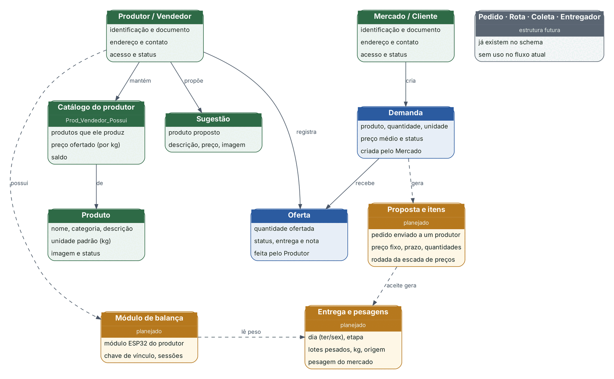<br><sub>Modelo conceitual <i>(documento v3.0)</i></sub></td>
<td width="33%">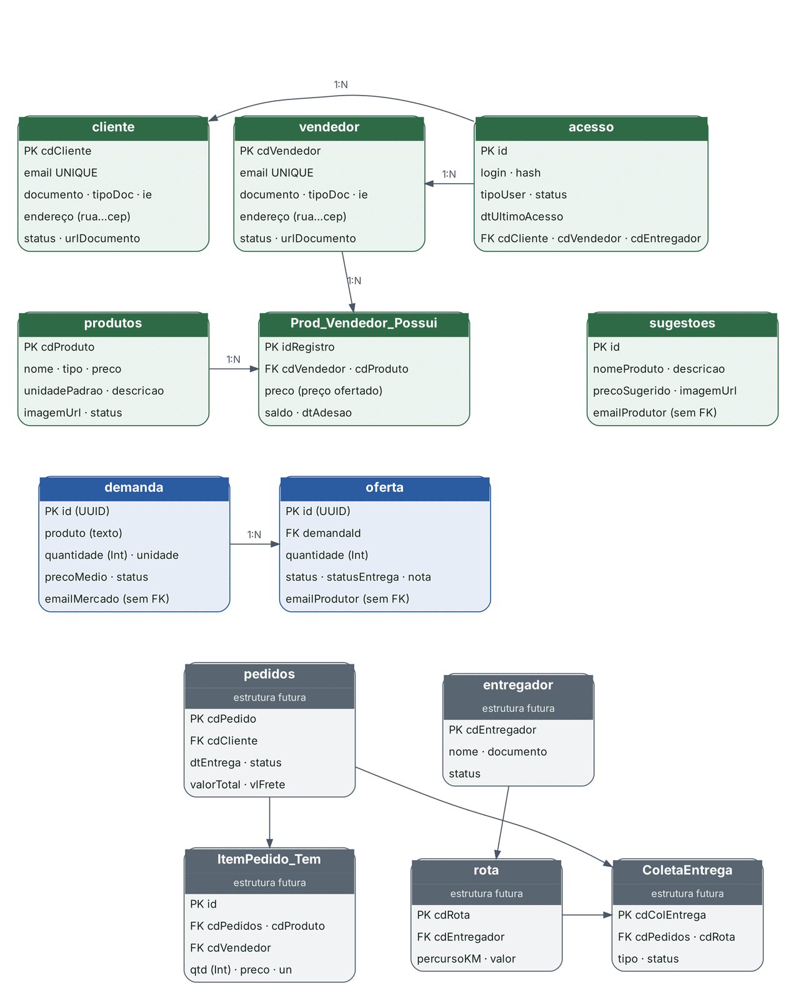<br><sub>Modelo lógico do schema <i>(documento v3.0, antes das tabelas da balança)</i></sub></td>
<td width="34%">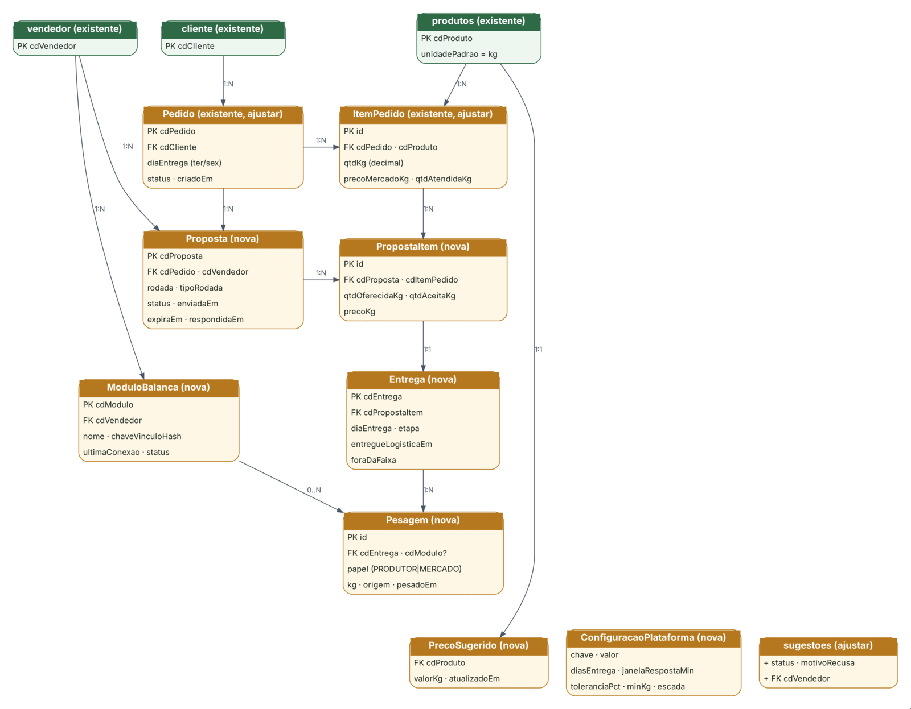<br><sub>Modelo proposto: propostas, entregas e pesagens <i>(documento v3.0)</i></sub></td>
</tr>
</table>

<details>
<summary><b>Classes, gateways e atividades</b> (documento v3.0)</summary>

| | |
| --- | --- |
| 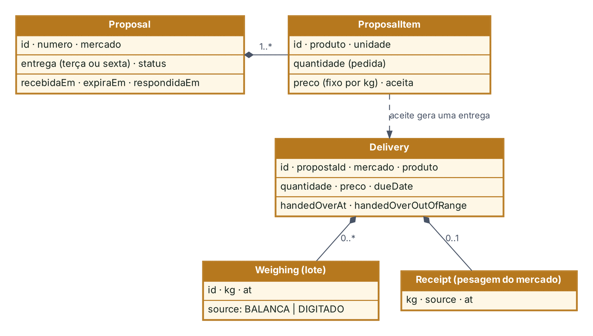 | 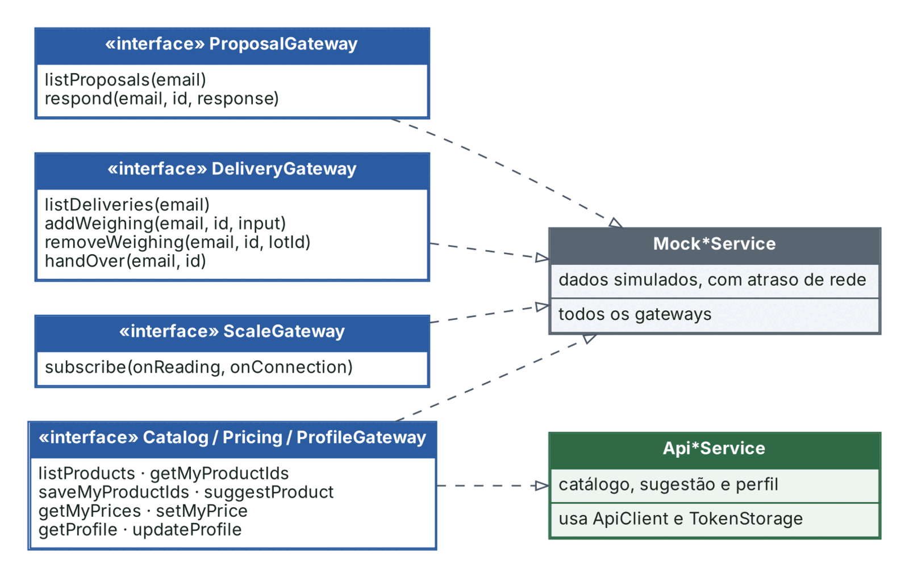 |
| 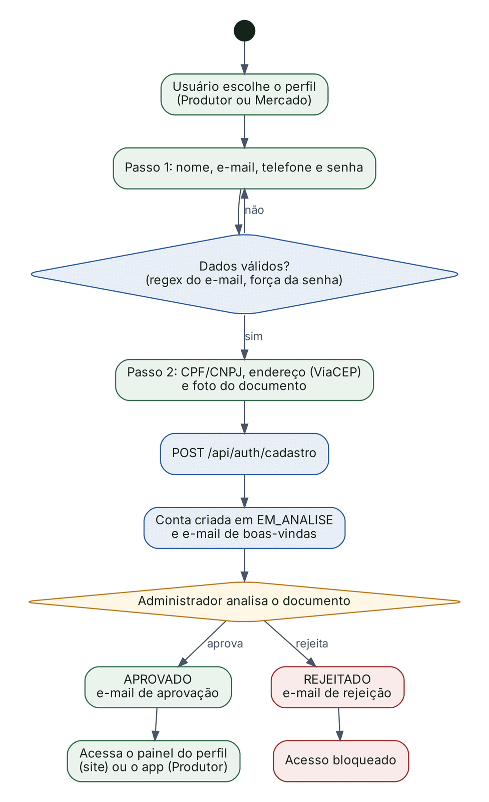 | 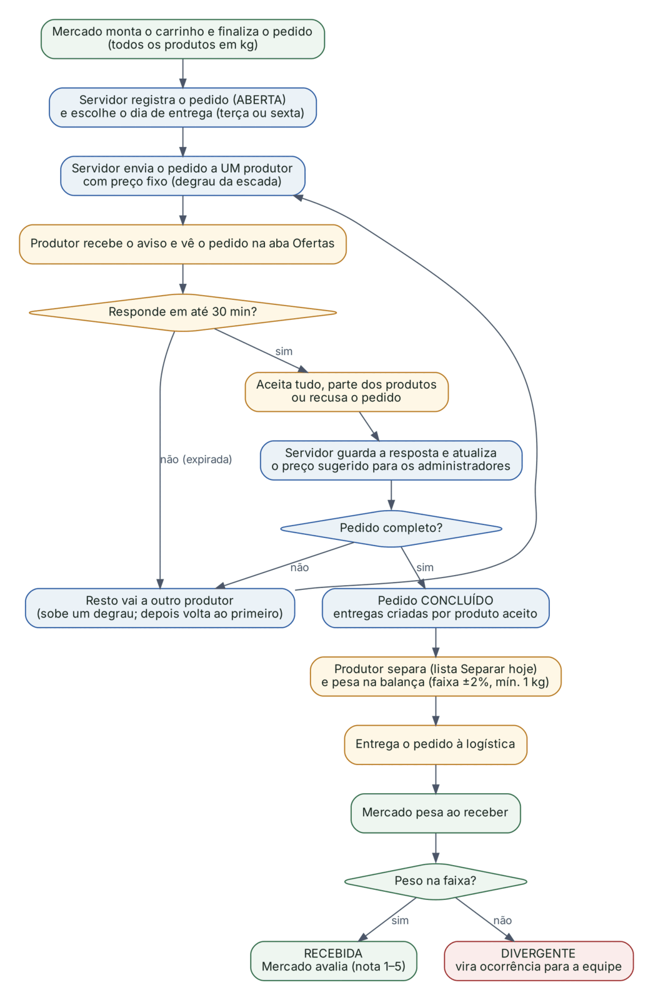 |

</details>

### 3.4 Arquitetura da solução

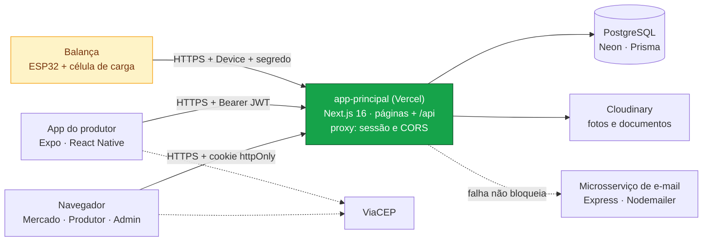

<details>
<summary><b>Camadas da aplicação web e do aplicativo</b> (documento v3.0)</summary>

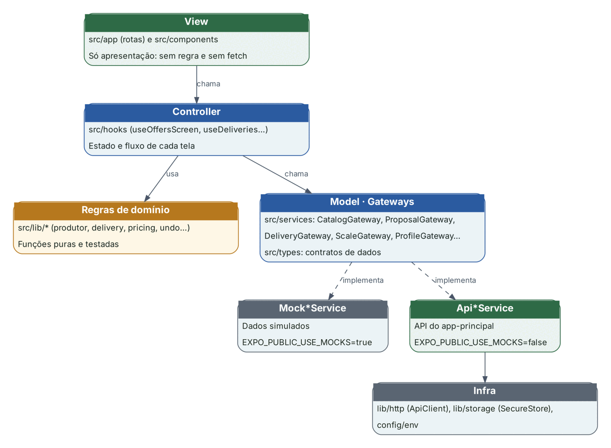

</details>

### 3.5 Autenticação e autorização

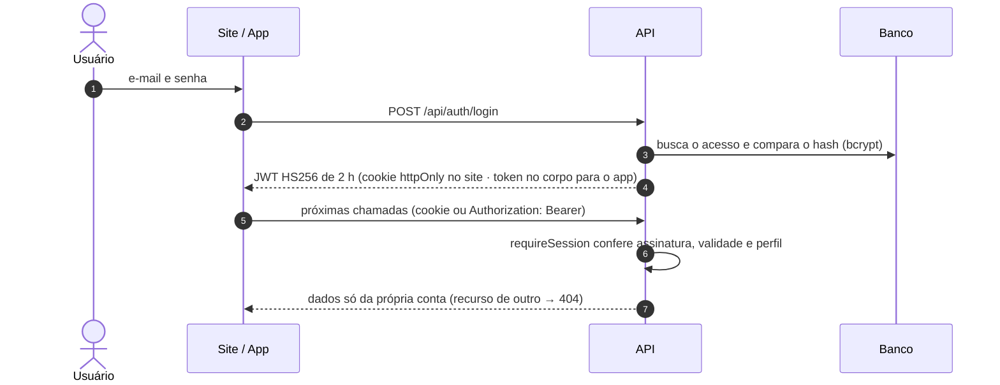

- **Falha fechada:** sem `JWT_SECRET` em produção, o login para de funcionar em vez de aceitar tokens forjados.
- **Tentativas limitadas:** login (5 em 15 min), troca de senha e código da etiqueta da balança.
- O app guarda o token no **SecureStore**; o site não guarda token no navegador (`GET /api/auth/me` diz quem está logado).

### 3.6 API RESTful

Todas as rotas estão no Swagger em **`/api-docs`**. Erros são sempre `{ "error": "mensagem" }`.

<details>
<summary><b>Ver as 44 operações</b></summary>

| Área | Rotas |
| --- | --- |
| Autenticação | `POST /api/auth/login` · `POST /api/auth/logout` · `GET /api/auth/me` · `POST /api/auth/cadastro` |
| Perfil | `GET/PUT/DELETE /api/perfil/meus-dados` · `GET /api/vendedor/perfil` · `GET /api/mercado/perfil` |
| Catálogo | `GET/POST/PUT/DELETE /api/produtos` |
| Produtor | `GET/POST /api/produtor/meus-produtos` · `GET/POST /api/produtor/ofertas` · `GET/POST/DELETE /api/produtor/sugestao` |
| Balanças do produtor | `GET/POST /api/produtor/balancas` · `PATCH/DELETE /api/produtor/balancas/{id}` · `PUT .../{id}/conectada` · `GET .../{id}/leitura` |
| Mercado | `GET/POST /api/mercado/demandas` · `PATCH /api/mercado/avaliar` · `PATCH /api/mercado/cancelar` |
| Administração | `GET/PUT/PATCH/DELETE /api/admin/usuarios` · `POST /api/admin/novo-admin` · `POST /api/admin/promover-sugestao` · `GET/POST /api/admin/balancas` · `PATCH/DELETE /api/admin/balancas/{id}` · `POST .../{id}/segredo` |
| Módulo da balança | `GET /api/iot/config` · `POST /api/iot/leituras` |
| Instalação | `GET /api/setup-admin` (cria só o primeiro administrador) |

</details>

**Próximas rotas** (propostas no documento, seção 3.9.3): pedidos de mercado e propostas com preço fixo, resposta do produtor dentro da janela, entregas por pedido e registro de pesagens.

### 3.7 Balança conectada (IoT)

O administrador cadastra o módulo pelo endereço MAC e recebe um **segredo** (o servidor guarda só o hash). A etiqueta da balança traz o MAC e um **código** derivado pelo servidor, que o produtor digita para vincular a balança: saber o MAC não basta para tomar a balança de outra pessoa. O módulo envia as leituras para `POST /api/iot/leituras`; o servidor guarda o último peso e, no histórico, só as leituras estáveis que mudaram; o app e o site consultam `GET .../leitura` a cada 0,5 s (2 s sem sinal).

Detalhes, firmware e teste sem hardware: [`app-principal/docs/IOT.md`](app-principal/docs/IOT.md).

### 3.8 Microsserviço de e-mail

Envia boas-vindas, aprovação, rejeição, suspensão, exclusão e avisos de sugestão. É independente: se falhar, o fluxo principal continua. Sem `MICROSERVICE_URL`, o site funciona sem enviar e-mails.

### 3.9 Design system

- **Web:** tokens em `app/globals.css` (verde de ação com contraste 5:1, neutros esverdeados, âmbar da balança), títulos em Bricolage Grotesque e interface em Figtree, kit em `components/ui`, marca em `components/brand`. O foco do teclado é visível, o "reduzir movimento" é respeitado e as janelas prendem o foco e fecham com Esc.
- **App:** tema em `src/theme`, componentes em `src/components/ui`, animações com versão reduzida, campos de 56 px e texto mínimo de 14 px.

| Tela | Web e app |
| --- | --- |
| Início, Catálogo, Ofertas, Entregas, Mais | mesmas telas e mesma ordem nos dois |
| Ofertas | tabela no computador, cartões no celular e no app |
| Pesagem | no app (perto da balança); no site, o peso ao vivo |

---

## 4. Testes

| Projeto | Ferramenta | Resultado |
| --- | --- | --- |
| Site e API | Vitest | **498 testes** em 62 arquivos: rotas, regras, validações e a conferência do Swagger |
| Aplicativo | Jest + jest-expo | **934 testes** em 88 suítes |
| Aplicativo (ponta a ponta) | Playwright na versão web | 10 roteiros rodados na refatoração (login, ofertas, produtor, recursos, telas de 320 px a tablet, senha, Mais, entregas, pesagem e peso mínimo); ainda não estão no repositório |
| Tipos e lint | `tsc --noEmit`, ESLint | sem erros nos dois projetos |

Antes de ligar o restante do app ao servidor: rodar os roteiros com a API real, testar o módulo ESP32 em bancada e validar o fluxo de pedidos e pesagem com dados de verdade.

---

## 5. Repositório e como executar

```
raiz_conecta/
├── app-principal/   Site + API (Next.js 16, Prisma, Tailwind 4)        → ARQUITETURA.md, docs/IOT.md
├── app-mobile/      App do produtor (Expo SDK 57, Expo Router)         → ARQUITETURA.md
├── microservico/    E-mails transacionais (Express, Nodemailer)
├── app-node/        Backend Express antigo (legado)
├── docs/            Guia de uso, figuras da documentação e imagens deste README
└── Raiz_Conecta_Documentacao.docx   Documentação completa (v3.0)
```

**Só o app, com dados simulados** (Node.js 20+):

```bash
cd app-mobile && npm install
cp .env.example .env          # EXPO_PUBLIC_USE_MOCKS=true
npx expo start                # Expo Go, emulador ou "w" para o navegador
```

No modo simulado qualquer e-mail e senha entram; a pesagem tem um simulador de balança.

**O site e a API** (Node.js 20+ e PostgreSQL):

```bash
cd app-principal && npm install
cp .env.example .env.local    # DATABASE_URL, JWT_SECRET, ADMIN_SENHA_INICIAL, CLOUDINARY_*
npx prisma generate
npx prisma db push            # cria as tabelas, inclusive as da balança
npm run dev                   # http://localhost:3000; na primeira vez, abra /api/setup-admin
```

<details>
<summary><b>Variáveis de ambiente</b></summary>

| Variável | Onde | Para quê |
| --- | --- | --- |
| `DATABASE_URL` | site | PostgreSQL |
| `JWT_SECRET` | site | **Obrigatória em produção** (32+ caracteres): assina os logins e gera os códigos das etiquetas |
| `ADMIN_SENHA_INICIAL` | site | Senha do primeiro administrador |
| `CLOUDINARY_*` | site | Fotos e documentos |
| `MICROSERVICE_URL` | site | Microsserviço de e-mail (opcional) |
| `CORS_ALLOWED_ORIGIN` | site | Origem do app na web (opcional) |
| `EXPO_PUBLIC_USE_MOCKS` / `EXPO_PUBLIC_API_URL` | app | Simulado ou real, e o endereço do site |

</details>

Passo a passo de uso por perfil (mercado, produtor, administrador e balança): [**Guia de uso**](docs/GUIA-DE-USO.md).

### Gestão ágil

| Sprint | Objetivo | Período | Histórias / pontos |
| --- | --- | --- | --- |
| Sprint 1 (PI) | Autenticação, cadastro, admin, catálogo, carrinho, checkout, produtor, landing, avaliações, e-mail | 08/04 a 29/04/2026 | 11 / 45 |
| Sprint 2 (PI 2) | Componentização, design system, filtros, validações, cancelamento, documentação da API, SCRUM-144 a 147 | 29/04 a 20/06/2026 | ~4 / ~14 |
| Fase do aplicativo e refatoração | App do produtor, segurança da API, balança conectada, site refeito | 2º semestre de 2026 | ver o Jira |

### Equipe

Daniel Henrique Domingues Nogueira · Felipe Gomes Felix · Guilherme Vinícius Baeza de Oliveira · Gustavo Henrique Bauch · Jhonatan Melo de Oliveira

Orientação: Profa. Cristiane Palomar Mercado, Prof. Tiago Vanderlei de Arruda e Prof. Jones Artur Gonçalves.

### Referências

- SOMMERVILLE, I. *Engenharia de software*. 10. ed. São Paulo: Pearson, 2016.
- PRESSMAN, R. S.; MAXIM, B. *Engenharia de software: uma abordagem profissional*. 9. ed. Porto Alegre: McGraw-Hill Education, 2021.
- DATE, C. J. *Introdução a sistemas de banco de dados*. 8. ed. Rio de Janeiro: Campus, 2004.
- FREEMAN, A. *Pro React 18*. New York: Apress, 2022.
- FLANAGAN, D. *JavaScript: o guia definitivo*. 8. ed. Sebastopol: O'Reilly Media, 2024.
- GARRETT, J. J. *Os elementos da experiência do usuário: design centrado no usuário para web*. 2. ed. São Paulo: Voices That Matter, 2010.
- EXPO. *Expo documentation*. Disponível em: https://docs.expo.dev.
- VERCEL. *Next.js documentation*. Disponível em: https://nextjs.org/docs.
- PRISMA. *Prisma ORM documentation*. Disponível em: https://www.prisma.io/docs.

<div align="center">
<br>
<sub>🌱 Raiz Conecta · Fatec Votorantim · 2026 · <a href="https://www.instagram.com/raizconecta_dsm">@raizconecta_dsm</a></sub>
</div>
