# Raiz Conecta — guia de uso

> Voltar ao [README](../README.md).

O Raiz Conecta liga produtores rurais a mercados e hortifrutis. O **mercado** monta uma cotação no site, os
**produtores** da região respondem pelo app (ou pelo site) e, no dia da entrega, o app guia a **pesagem** de cada
produto, de preferência com a **balança conectada**. O **administrador** aprova as contas e cuida do catálogo.

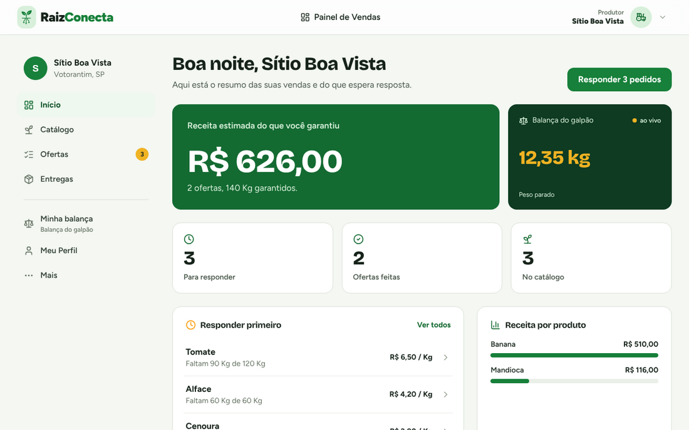

## Sumário

- [Como rodar](#como-rodar)
- [Criar conta e entrar](#criar-conta-e-entrar)
- [Mercado: cotação](#mercado-cotação)
- [Produtor no app](#produtor-no-app)
  - [Painel](#painel)
  - [Catálogo](#catálogo)
  - [Ofertas](#ofertas)
  - [Entregas e pesagem](#entregas-e-pesagem)
  - [Mais, perfil e configurações](#mais-perfil-e-configurações)
- [Produtor no site](#produtor-no-site)
- [A balança conectada](#a-balança-conectada)
- [Administrador](#administrador)
- [O que é simulado hoje](#o-que-é-simulado-hoje)
- [Perguntas frequentes](#perguntas-frequentes)

## Como rodar

O passo a passo de instalação está no [README](../README.md#5-repositório-e-como-executar). Resumo:

| Quero ver... | Comando | Precisa de |
| --- | --- | --- |
| Só o app, com dados de exemplo | `cd app-mobile && npm install && cp .env.example .env && npx expo start` | Node.js 20+ |
| O site e a API | `cd app-principal && npm install && cp .env.example .env.local && npx prisma db push && npm run dev` | Node.js 20+ e PostgreSQL |
| O app falando com o site | `EXPO_PUBLIC_USE_MOCKS=false` e `EXPO_PUBLIC_API_URL` no `.env` do app | O site no ar |

No modo simulado do app **qualquer e-mail e senha entram**. E-mails que começam com `analise@`, `rejeitado@`,
`suspenso@` ou `mercado@` mostram cada bloqueio; a senha `errada` mostra o erro de login.

## Criar conta e entrar

O cadastro tem **dois passos** e passa por aprovação da equipe antes de liberar o acesso.

1. **Passo 1** — tipo de conta (produtor ou mercado), nome, e-mail, telefone e senha. A senha mostra na hora só as
   regras que ainda faltam (8 caracteres, maiúscula, minúscula, número e símbolo).
2. **Passo 2** — CPF ou CNPJ, endereço (o **CEP preenche rua, bairro e cidade**) e a foto de um documento
   (RG, CNH, contrato social ou cartão CNPJ).
3. **Cadastro enviado** — a tela avisa para ficar de olho no **e-mail** (e no spam). Até a aprovação, quem tenta
   entrar vê "Conta em análise".

| Entrar | Cadastro (app) | Cadastro enviado (site) |
| --- | --- | --- |
| 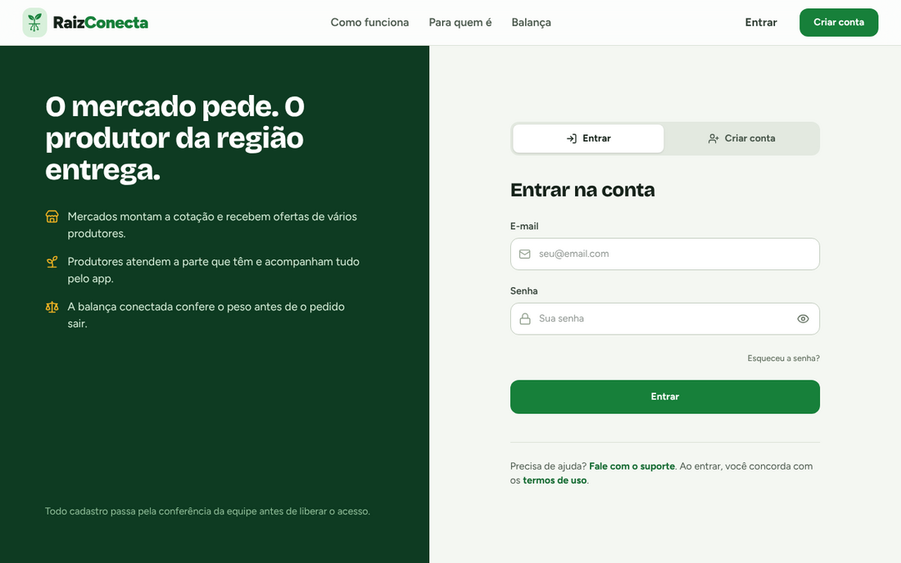 | 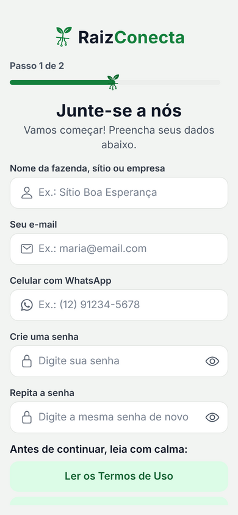 | 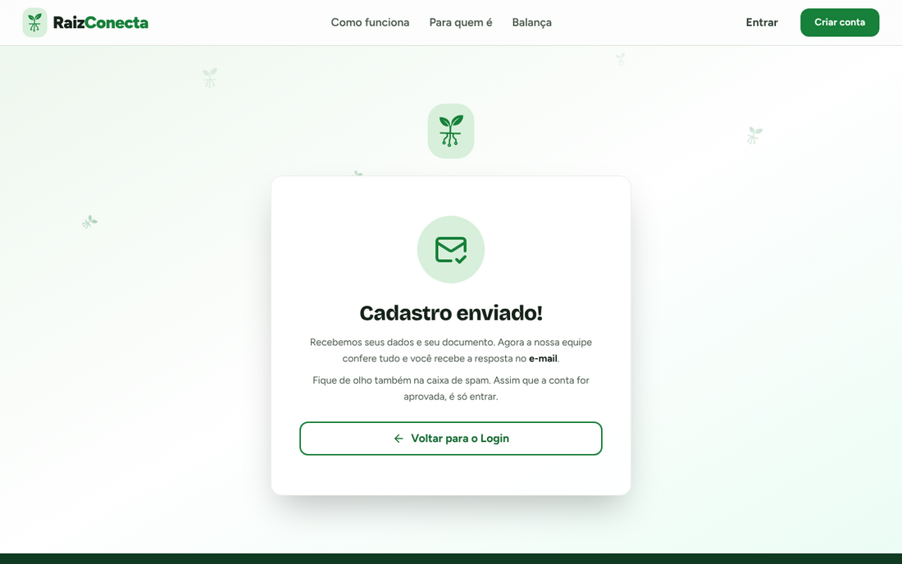 |

> A senha do passo 1 nunca é gravada no navegador: fica só na memória da página. Recarregar volta ao passo 1.

## Mercado: cotação

Tudo no site, em **Painel de Compras**.

1. **Nova cotação** — busque pelo nome, filtre por categoria ou ordene por preço. Em cada produto, escolha a
   quantidade (− e + ou digite) e toque em **Adicionar**. A cotação aparece ao lado, com a estimativa pelo preço
   de referência, e continua lá se a página recarregar.
2. **Revisar e disparar** — confira as quantidades e o endereço de entrega e toque em **Confirmar disparo**. Os
   produtores da região recebem o pedido.
3. **Minhas cotações** — acompanhe o que cada cotação já recebeu de oferta. Depois da entrega, **avalie o
   produtor**. Uma cotação pode ser **cancelada em até 7 dias úteis**.

| Catálogo e cotação | Revisar e disparar |
| --- | --- |
| 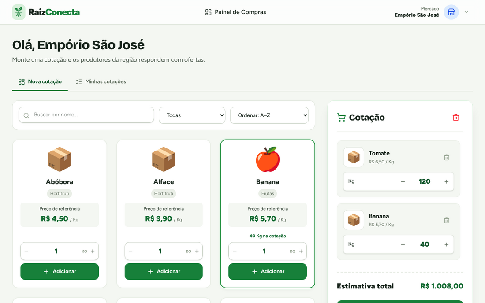 | 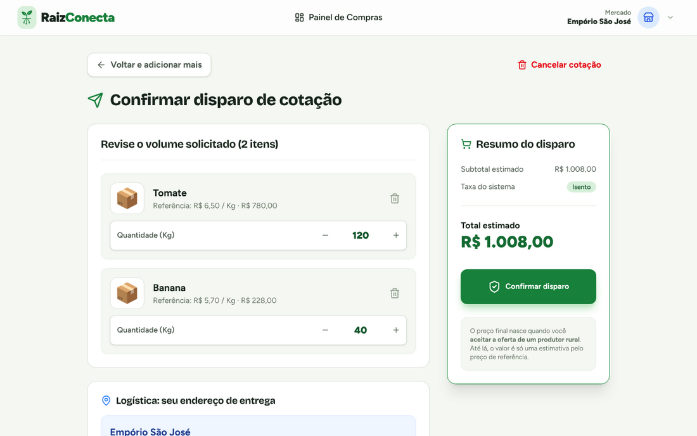 |

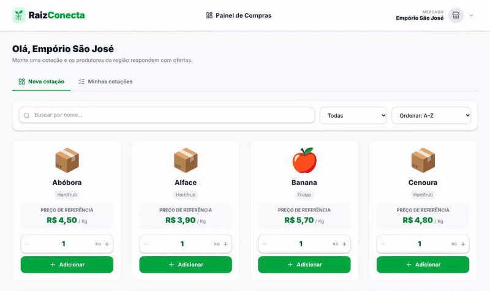

## Produtor no app

A barra de baixo tem **Catálogo**, **Ofertas**, o botão redondo **Início** no meio, **Entregas** e **Mais**. O
login sempre abre o Painel.

### Painel

Receita estimada do que foi aceito, o cartão **Próxima entrega** (quantos pedidos separar até o próximo dia), os
contadores *Para responder*, *Aceitos* e *No catálogo*, a receita por produto e os **3 pedidos com prazo mais
curto** em *Responder primeiro*.

### Catálogo

Marque os produtos que você produz: só eles aparecem nas Ofertas. Pelo lápis de cada produto você informa o
**preço que pede por kg** (é uma informação para a equipe, não o preço das propostas). Não achou o produto?
**Sugerir novo produto** (com foto) manda a sugestão para a administração.

### Ofertas

Os pedidos chegam agrupados **por mercado**, com **preço fixo por produto** e **30 minutos** para responder.

1. Toque no mercado para ver os pedidos e os produtos.
2. Em cada produto, escolha **quanto você atende**: arraste a barra, digite ou use − e +. Os dois números grandes
   mostram o **PEDIDO** e o que **VOCÊ OFERECE**. Começa tudo em 0, para nada ser aceito sem querer.
3. **Confirmar quantidades** (ou *Aceitar tudo* / *Recusar pedido*). O que você não atendeu segue para outros
   produtores.

O que foi aceito vira **entrega** no dia combinado (por ora, terça ou sexta).

| Ofertas | Entregas |
| --- | --- |
| 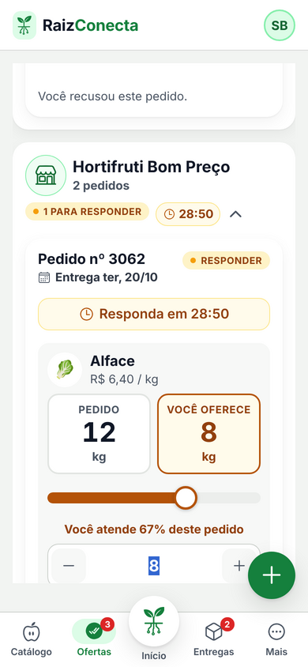 | 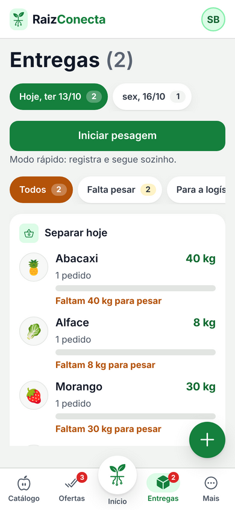 |

### Entregas e pesagem

**Entregas** mostra os pedidos por dia e por mercado, a lista **Separar hoje** (o total de cada produto no dia) e
os filtros *Falta pesar* e *Para a logística*.

1. Toque em **Iniciar pesagem**. O app diz o mercado e o produto ("Empório São José. Coloque na balança 8 quilos
   de alface.").
2. A tela mostra em destaque **o que o mercado pediu** e a **faixa aceita** (tolerância de **±2%**, mínimo de 1 kg).
3. Coloque o produto na balança. Enquanto o peso oscila, o botão fica laranja com cadeado (*Carga irregular*).
4. Quando o peso **fica parado 5 segundos dentro da faixa**, o app registra sozinho (modo rápido) ou libera o
   **Registrar** (modo manual).
5. A confirmação verde avisa **"Retire o produto da balança"** e mostra o próximo. A voz só fala o próximo
   produto quando ele aparece na tela.
6. Entre um pedido e outro há uma pausa de 5 s: **Pesar agora** ou **Deixar para depois**.

| Pedido e faixa | Peso firmando | Confirmação |
| --- | --- | --- |
| 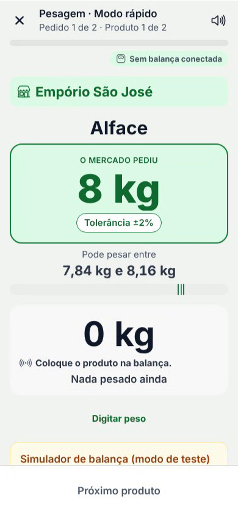 | 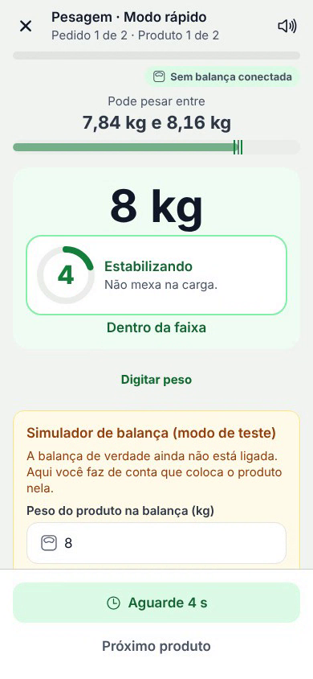 | 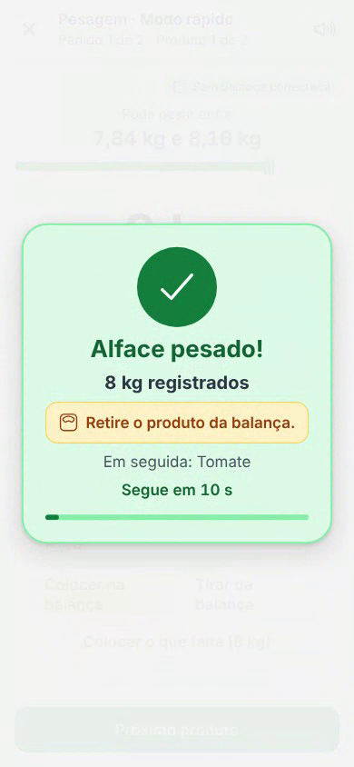 |

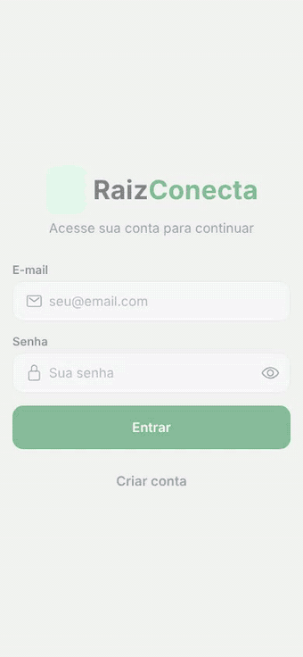

**Fora da faixa nada é registrado sozinho:** abaixo do mínimo o botão fica laranja; acima do pedido, vermelho e
bloqueado. Com todos os produtos pesados, **Entregar o pedido à logística**. Sem balança, **Digitar peso**.

> No modo simulado, a tela de pesagem tem um **Simulador de balança**: digite o peso e toque em *Colocar na balança*.

### Mais, perfil e configurações

- **Meu Perfil** — nome, telefone, endereço, ícone da conta e senha. **Trocar a senha pede a senha atual.**
- **Minha balança** — veja [A balança conectada](#a-balança-conectada).
- **Configurações** — *Pesagem automática (modo rápido)*, *Voz na pesagem*, o nome da balança conectada e
  *Reduzir animações*.
- **Ajuda** — perguntas e respostas sobre a tela em que você está. **Desfazer** — as últimas ações (catálogo,
  preço, sugestão, perfil) podem ser desfeitas por 1 minuto.

| Mais | Balanças |
| --- | --- |
| 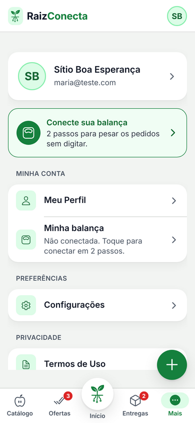 | 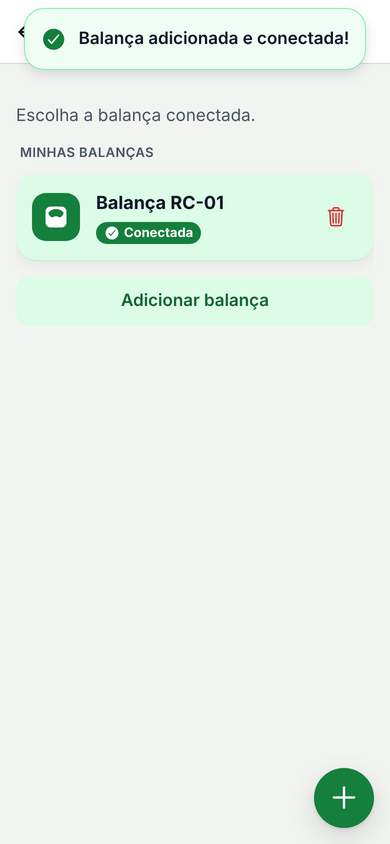 |

## Produtor no site

O site tem as **mesmas telas** do app, adaptadas para a tela grande. No computador, um menu lateral fixo traz as
cinco abas e, logo abaixo, **Minha balança** e **Meu Perfil** (no app eles ficam dentro de Mais). No celular, o site
usa a barra de abas do app, com o Início no meio.

| Tela | O que faz |
| --- | --- |
| **Início** | Receita garantida, a balança ao vivo, os contadores, o que responder primeiro e a receita por produto |
| **Catálogo** | Marcar o que você produz, com preço por kg opcional, e sugerir produto |
| **Ofertas** | No computador, uma tabela: produto, andamento do pedido e quanto você garante, na própria linha. No celular, cartões |
| **Entregas** | Como pesar um pedido no app, passo a passo, e a balança conectada ao lado |
| **Minha balança** | Conectar, renomear, trocar, remover e ver o **peso ao vivo** |
| **Meu Perfil** | Os mesmos dados do app; a troca de senha pede a senha atual |

| Ofertas | Minha balança | No celular |
| --- | --- | --- |
| 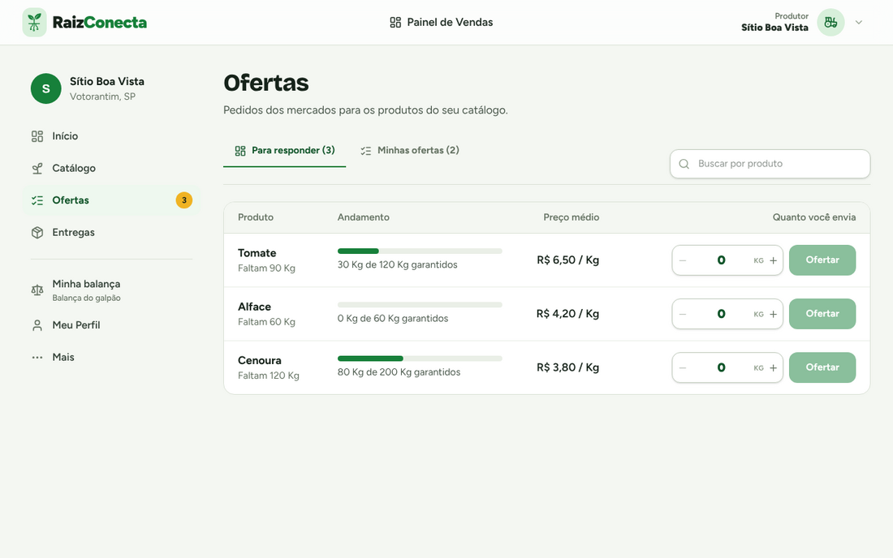 | 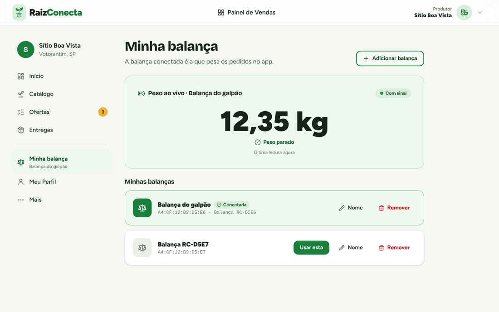 | 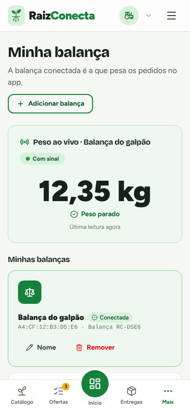 |

## A balança conectada

A balança é um **ESP32 com célula de carga** que manda o peso pelo Wi-Fi para o servidor. O app e o site leem o
mesmo peso.

1. **Administrador** — em *Balanças*, **Cadastrar balança** com o endereço MAC. O site mostra o **segredo uma
   única vez**: grave-o no módulo (firmware em `app-principal/docs/iot/raiz_balanca`). A tabela mostra o **código
   da etiqueta** (XXXX-XXXX) para imprimir e colar na balança.
2. **Produtor** — em *Minha balança → Adicionar balança* (no app, em *Mais → Minha balança*), digite o **endereço** e o **código da etiqueta**. Se a
   etiqueta tiver QR Code, cole o texto dele (`RC:<MAC>:<CÓDIGO>`) no primeiro campo e os dois se preenchem.
3. A balança fica **conectada**: é ela que pesa no app. Com várias, só uma fica conectada por vez (*Usar esta*).
4. **Peso ao vivo** — atualiza a cada meio segundo. *Peso parado* quando estabiliza; *Sem sinal* quando o módulo
   passa de 15 s sem falar com o servidor.

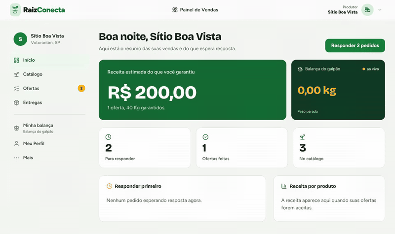

> O código da etiqueta é calculado pelo servidor a partir do MAC: saber o endereço da balança não basta para
> vinculá-la a outra conta. Errar o código muitas vezes trava as tentativas por um tempo.

Sem hardware, o roteiro com `curl` está em [IOT.md](../app-principal/docs/IOT.md#testar-sem-hardware).

## Administrador

Em **Central Admin**:

| Aba | O que faz |
| --- | --- |
| **Visão geral** | Totais de usuários, produtores, mercados, produtos e balanças com sinal; o que precisa de atenção |
| **Aprovações** | Ver o documento enviado e **aprovar** ou **recusar** (com o motivo) |
| **Usuários** | Buscar, filtrar, editar, suspender, reativar ou excluir contas; criar outro administrador |
| **Catálogo** | Cadastrar, editar (com foto) e desativar produtos — produto com histórico é desativado, não apagado |
| **Sugestões** | Transformar a sugestão de um produtor em produto do catálogo, ou descartá-la |
| **Balanças** | Cadastrar o módulo, ver o código da etiqueta e o sinal, gerar novo segredo, **liberar** de um produtor |

| Visão geral | Balanças |
| --- | --- |
| 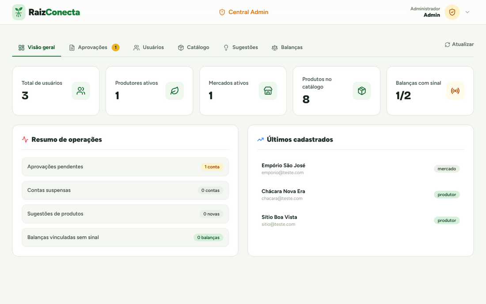 | 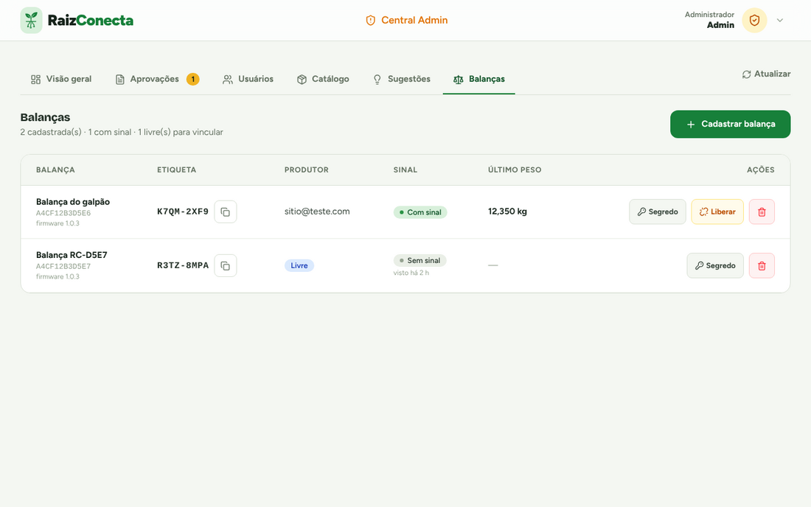 |

## O que é simulado hoje

| Parte | Situação |
| --- | --- |
| Login, cadastro, catálogo, sugestão, perfil | **Real** (site e app) |
| Balança: vínculo e peso ao vivo | **Real** (API e firmware de exemplo) |
| Cotação do mercado, ofertas do mural, avaliação, cancelamento | **Real** no site |
| Propostas com preço fixo e prazo (app), entregas, registro da pesagem, pesagem do mercado | **Simulado no app** — o site ainda não tem essas rotas |

## Perguntas frequentes

**Esqueci a senha.** Ainda não há recuperação automática: fale com o suporte (`suporte@raizconecta.com.br`).

**Minha conta está "em análise" há dias.** A equipe confere o documento manualmente; a resposta chega por e-mail.

**A balança aparece "Sem sinal".** Confira se ela está ligada e no Wi-Fi. O app avisa quando o módulo passa de 15 s
sem mandar leitura; sem balança, use **Digitar peso**.

**Pesei a mais e o app não deixou registrar.** É de propósito: o máximo da faixa é um limite (±2% do pedido). Tire
um pouco do produto até o peso entrar na faixa.

**O app diz "EXPO_PUBLIC_API_URL não definida".** Copie `.env.example` para `.env` no `app-mobile`.
